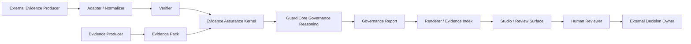

# Evidence Assurance Kernel v0.1

Status: Draft architecture specification with bounded PoC implementation notes on 2026-08-27.

## 1. Purpose

[Repo] MindForge Guard already has a canonical factual input (`Evidence Pack`), a deterministic explanatory layer (`reason codes`, `missing_evidence`, `human_review_requirements`, `next_actions`), and a canonical consumer-facing output (`GovernanceReportModel`).

[Strategic Baseline] The next strategic step is not a new platform category. It is to turn existing evidence validation and external verification work into a clearer assurance layer that can express what evidence supports, what it does not support, what remains missing, and what uncertainty remains.

[Recommendation] Evidence Assurance Kernel v0.1 should be defined as a Guard Core interpretation layer that consolidates:

- pack-bounded evidence coverage and reason-code semantics;
- external evidence normalization and verification semantics;
- supportability, admissibility, contradiction, and residual-uncertainty semantics;
- existing verdict ownership inside `GovernanceReportModel`.

It must not become a third competing verdict engine, a hosted control plane, or an approval authority.

## 2. Repository Context And Preserved Invariants

[Repo] Observed baseline on 2026-08-27:

- branch: `main`
- `HEAD`: `e861fb725ce9436e5e22735f0a88db7682b84b09`
- `origin/main`: `e861fb725ce9436e5e22735f0a88db7682b84b09`
- latest tag: `v7.0.1`
- strategic baseline file exists at `docs/strategy/mindforge-guard-next-strategic-directions-assessment-v0.1.md` and is currently untracked in the working tree

[Repo] Current boundary sources reviewed:

- `AGENTS.md`
- `README.md`
- `docs/product-boundary.md`
- `docs/product/current/v7_0_1_commercial_baseline.md`
- `docs/adr/0001-guard-first.md`
- `docs/adr/0002-harness-as-producer.md`
- `docs/adr/0003-non-executing-local-first.md`
- `docs/evidence-contract-v1.md`
- `docs/evidence-flow.md`
- `docs/governance-report-model.md`
- `docs/normalized-evidence-record-v0.1.md`
- `docs/external-evidence-framework-v0.1-boundary.md`
- `docs/studio-prototype.md`
- `prototypes/studio/studio-prototype.md`

[Recommendation] This specification preserves:

- `audit` output / verdict / exit unchanged
- `permit` behavior unchanged unless explicitly scoped later
- `classify` behavior unchanged unless explicitly scoped later
- recommendation-only
- additive-only
- non-executing
- default-off where applicable
- no authority scope expansion

## 3. Current Architecture Reconciliation

### Existing Evidence / Report Semantics Map

| Existing concept | Current source | Current semantics | Treatment |
| --- | --- | --- | --- |
| Evidence Pack | `packages/guard-core/src/parseEvidencePack.ts`, `docs/evidence-contract-v1.md` | Canonical factual input boundary | Keep |
| Evidence Contract | `packages/schema/evidence-schema-v1.json`, `validateEvidencePack.ts` | Closed structural contract for submitted evidence | Keep |
| Evidence Coverage | `inspectEvidenceCoverage.ts` | Structural completeness and gap detection over pack-bounded evidence | Extend |
| Missing Evidence | `inspectEvidenceCoverage.ts`, `reportModel.ts` | Explicit missing or weak evidence surfaced as report items | Extend |
| Reason Code | `reasonCodes.ts` | Canonical explanatory primitive vocabulary | Keep |
| Governance Report | `generateGovernanceReport.ts`, `reportModel.ts` | Canonical Guard-owned summary and verdict carrier | Keep |
| Governance Verdict | `reportModel.ts`, `generateGovernanceReport.ts` | Existing `allow / require_review / block / inconclusive` vocabulary | Keep |
| Evidence Index | `generateEvidenceIndex.ts` | Traceability index over report evidence refs and derived items | Keep |
| Normalized Evidence Record | `externalEvidence/types.ts`, `docs/normalized-evidence-record-v0.1.md` | Guard-owned normalized external evidence artifact | Keep |
| External Finding | `externalEvidence/types.ts` | Adapter-level verification interpretation | Keep |
| Assurance Report | `externalEvidence/verificationTypes.ts`, `localAssuranceReportFixture.mjs` | External-evidence-scope verification and profile result artifact | Clarify |
| Report Integrity | `externalEvidence/localAssuranceReportIntegrity.mjs`, `verificationTypes.ts` | Integrity observation on assurance artifacts | Keep |
| Verifier | `verification[]` in Evidence Pack, adapter `verify(...)`, preview explain/drift surfaces | Actor/component that executes bounded verification | Clarify |
| Adapter | `externalEvidence/types.ts`, `registryTypes.ts` | Parse / validate / verify / normalize / finding emission layer | Keep |
| Verification Job | `verificationTypes.ts`, `minimalServiceApiTypes.ts` | Service-shaped job boundary for external evidence only | Clarify |
| Human Review | `human_review` in pack, `human_review_requirements` in report | Human review request and reviewer-facing residual decision point | Extend |

### Governance Report vs External Assurance Report

[Repo] `GovernanceReportModel` is the canonical Guard-wide output contract for pack-level governance reasoning. `AssuranceReport` is an external-evidence-scope artifact that summarizes checks, findings, missing evidence, and human review recommendations for one external evidence package and one or more assurance profiles.

[Recommendation] Their roles should be consolidated, not split:

- `AssuranceReport` remains the external-evidence verification artifact.
- `GovernanceReportModel` remains the final Guard report and verdict carrier.
- Evidence Assurance Kernel consumes external normalized records, findings, and assurance reports when external evidence is present, then feeds consolidated findings into Governance Report generation.
- No new top-level report family should become the final decision surface.

## 4. Conceptual Model

| Concept | Kernel definition | Repository fit |
| --- | --- | --- |
| Evidence Source | The producer or system from which evidence originates | Extends `producer`, external `source`, and adapter identity |
| Claim | A stated conclusion or assertion carried by submitted or external evidence | New explicit kernel concept; today claims are implicit in declarations and checks |
| Observation | A bounded fact observed in evidence or verification output | Extends actions, tool calls, blocked actions, artifacts, diagnostics, findings |
| Evidence Item | The concrete object Guard cites, inspects, hashes, verifies, or traces | Extends artifacts, evidence refs, normalized records, assurance checks |
| Verifier | The component or actor that performed bounded verification | Extends `verification[]`, adapter `verify`, preview explain/drift derivations |
| Verification | A concrete verification act with method, scope, inputs, result, and limitations | Extends pack verification entries and external verification result |
| Supportability | What conclusion an evidence item can support, cannot support, or only partially support | New kernel concept |
| Admissibility | Whether an evidence item may be used for a specific profile conclusion | New kernel concept; future-aligned with existing admissibility preview line |
| Independence | How separate the evidence producer is from the verifier and corroborating sources | New kernel concept built from current declared/verified boundaries |
| Contradiction | Visible conflict between claims, observations, versions, or sources | New kernel concept |
| Residual Uncertainty | What remains unproven after available verification completes | New kernel concept |
| Human Disposition | Reviewer action over evidence state, not Guard approval authority | Extends `human_review_requirements` and current trial/review docs |

### Minimal Independence Claim Model

[Recommendation] Kernel v0.1 should avoid one overloaded "trust level" field. It should record four bounded dimensions:

1. `origin_posture`: `declared`, `producer_emitted`, `externally_emitted`
2. `verification_posture`: `not_verified`, `partially_verified`, `verified`
3. `integrity_posture`: `not_checked`, `bound`, `mismatch`, `unavailable`
4. `corroboration_posture`: `single_source`, `cross_source`, `not_applicable`

[Recommendation] Guard may only say "independently verified" when:

- verification evidence is separate from the producer declaration;
- the verifier identity is explicit;
- the verifier did more than copy producer-declared values; and
- the result still carries any limitations and residual uncertainty.

Guard must not use "independently verified" for copied declarations, normalization-only mapping, or fixture-only preview derivations.

### Missing Evidence

[Recommendation] Kernel v0.1 should distinguish:

- `structural_missing_evidence`: required by the Evidence Pack or normalized artifact shape
- `conclusion_missing_evidence`: required for a specific assurance profile conclusion

### Decision Effect

[Recommendation] Kernel findings should map as:

`Evidence assurance finding -> governance reasoning inputs -> existing Governance Report verdict`

Kernel finding statuses should remain internal and bounded, for example:

- `supported`
- `unsupported`
- `contradicted`
- `insufficient_evidence`
- `inadmissible`

These do not replace the final report verdict vocabulary.

## 5. Kernel Placement And Trust Boundary

[Recommendation] Kernel placement:

`Evidence Pack + external normalized records / assurance reports -> Evidence Assurance Kernel -> Governance reasoning -> Governance Report -> Renderer / Studio / export surfaces`



[Recommendation] Fixed boundary rules:

- producer produces facts or declarations
- adapter transforms format, not trust
- verifier performs bounded verification
- kernel forms assurance findings
- governance reasoning forms final Guard verdict
- renderer and Studio present results only
- human reviewer and external decision owner retain final business decision authority

## 6. Assurance Profile Model

[Recommendation] Kernel v0.1 should support a stable kernel plus bounded profiles.

### Assurance Profile

Minimum conceptual fields:

- `profile_id`
- `profile_version`
- `purpose`
- `required_evidence`
- `optional_evidence`
- `admissibility_rules`
- `verification_requirements`
- `supportability_rules`
- `missing_evidence_rules`
- `contradiction_handling`
- `decision_review_mapping`

[Recommendation] Extension points may later support:

- Production Evidence Readiness
- Third-Party Evidence Review
- Temporal Authority
- Release Continuity
- Incident Evidence

Only Production Evidence Readiness is fully scoped in v0.1.

## 7. Determinism Requirements

[Repo] Current pack parsing, validation, governance report generation, evidence indexing, preview explain/drift, and external local fixtures all assume deterministic inputs and stable output contracts.

[Recommendation] Kernel v0.1 must require:

- canonical input ordering for claims, observations, verifications, findings, and contradictions
- same input + same profile + same verifier versions = same kernel result
- version-pinned profiles and verifier identities
- explicit provenance for derived findings
- external nondeterministic processes treated as evidence inputs, not live kernel behavior
- hashing over canonical serialized assurance result payloads

## 8. Contradiction And Residual Uncertainty Semantics

### Contradiction Matrix

| Case | Kernel effect | Governance effect |
| --- | --- | --- |
| Claimed vs observed mismatch | Contradiction finding | At least `require_review`; never hidden |
| Declared vs independently verified mismatch | Contradiction + integrity/supportability downgrade | `require_review` or `inconclusive` |
| Producer A vs producer B mismatch | Contradiction + source map retention | Visible reviewer item |
| Old vs current evidence mismatch | Change / drift or contradiction depending profile | Review item; future temporal hook |
| Required evidence absent | Conclusion-specific missing evidence | `require_review` or `inconclusive` |
| Evidence verified but conclusion unsupported | Unsupported conclusion + residual uncertainty | Must not silently become `allow` |

[Recommendation] Residual uncertainty must be first-class even when verification succeeds. Examples:

- scope was verified but outcome evidence is absent
- signature is valid but issuer trust remains unknown
- producer evidence is parseable but not independently corroborated
- runtime evidence is fresh enough for one claim but not for another

## 9. Assurance Result Model

[Recommendation] Kernel should produce an internal assurance result object, not a new public verdict surface.

### Conceptual outline

```json
{
  "subject": {
    "subject_id": "workflow-or-evidence-subject",
    "subject_type": "ai_workflow_review"
  },
  "profile": {
    "profile_id": "production_evidence_readiness",
    "profile_version": "0.1"
  },
  "sources": [],
  "claims": [],
  "observations": [],
  "verifications": [],
  "findings": [],
  "supportability": [],
  "contradictions": [],
  "missing_evidence": [],
  "residual_uncertainty": [],
  "provenance": {
    "kernel_version": "0.1",
    "deterministic": true
  },
  "integrity": {
    "result_hash": "sha256:..."
  },
  "human_review_requirement": true
}
```

[Recommendation] Canonical repository fields should be reused where available:

- `reason_codes`
- `missing_evidence`
- `human_review_requirements`
- `evidence_refs`
- `provenance`

## 10. Relationship To Evidence Contract v1

| Option | Advantages | Risks | Compatibility | Recommendation |
| --- | --- | --- | --- | --- |
| A. Extend Evidence Contract v1 directly | One object line | Overloads producer input with Guard-derived semantics | Weak | Not recommended |
| B. Add a new assurance envelope beside the pack | Separates producer facts from assurance | Risks a third user-facing report line if not controlled | Medium | Partial |
| C. Extend Governance Report directly with all assurance semantics | Reuses final output surface | Mixes evidence reasoning internals with final consumer contract too early | Medium | Partial |
| D. Compose current structures: keep Evidence Contract v1, keep Governance Report, keep external assurance artifacts, add internal kernel result feeding Governance Report | Lowest semantic breakage, highest additive fit | Requires disciplined mapping layer | Strong | Recommended |

### Recommended Architecture Option

[Recommendation] Option D.

- Evidence Contract v1 stays the factual input boundary.
- External normalized records and assurance reports stay verification-scope artifacts.
- Kernel result stays Guard-owned internal interpretation state.
- Governance Report remains the final Guard verdict carrier.
- Evidence Index, renderers, and Studio remain downstream-only consumers.

## 11. Compatibility And Migration Impact

| Surface | Impact |
| --- | --- |
| `v7.0.1` CLI commands | No Change |
| Evidence Pack v1 | No Change |
| Governance Report | Additive |
| Evidence Index | Additive |
| Renderer | Additive |
| Studio prototype | Additive |
| External Evidence fixtures | Extension |
| Licensing / License Hub | No Change |
| Authority / transition previews | No Change now; future extension point |

[Recommendation] v0.1 implementation should prefer additive internal types and report-field extensions over contract rewrites.

## 12. Terminology And Boundary Debt

| Existing term | Risk | Current meaning | Recommended treatment |
| --- | --- | --- | --- |
| `permit` | Sounds authority-granting | Existing governance line artifact | Keep current released meaning; avoid reusing in kernel naming |
| `gate` | Suggests blocking ownership | Opt-in governance and preview line terminology | Keep existing surfaces unchanged; avoid new kernel "gate" language |
| `allow` | Can be mistaken for approval | Current report verdict value | Clarify as Guard recommendation outcome, not execution authority |
| `block` / `deny` | Can sound enforcement-owned | Existing verdict vocabulary in some lines | Preserve released semantics; always pair with non-executing explanation |
| `approval` | Implies owned business decision | Human/external review concept appears across docs | Normalize to reviewer disposition or external decision owner |
| `production ready` | Overstates Guard claim | Common shorthand risk | Prefer "production evidence readiness" |
| `certify` / `certification` | Overstates assurance outcome | Not a current product right | Prohibit in kernel and validation language |

## 13. Negative Architecture Cases

[Recommendation] Evidence Assurance Kernel does not become:

- runtime execution
- business-action blocking authority
- IAM or permission granting
- owned approval
- agent orchestration
- staging platform
- monitoring or SIEM
- generic GRC platform
- hidden chain-of-thought inspection
- certification or legal compliance authority

## 14. Threat / Failure Model

| Threat / failure | Kernel posture |
| --- | --- |
| Forged evidence | Partially detect / represent |
| Copied context | Represent; future corroboration needed |
| Stale evidence | Detect or represent when timestamps exist |
| Replayed evidence | Partially detect with idempotency / provenance context |
| Producer / verifier collusion | Represent limits; cannot fully detect |
| Unverifiable claim | Represent as unsupported or insufficient |
| Missing provenance | Detect / represent |
| Incorrect scope | Detect or represent via contradiction and supportability |
| Version mismatch | Detect |
| Contradictory evidence | Detect / represent |
| Partial evidence | Detect / represent |
| Unknown verifier | Detect / represent |
| Expired authority evidence | Detect when bounded time windows exist |
| Canonicalization mismatch | Detect when hashes or deterministic serialization disagree |
| Tampered report | Partially detect via integrity observations |

## 15. Project Context Traceability

| Decision / Proposal | Existing Repository Basis | Strategic Assessment Basis | New Inference |
| --- | --- | --- | --- |
| Keep Governance Report as final verdict surface | `reportModel.ts`, `generateGovernanceReport.ts`, Studio boundary | "do not introduce third verdict engine" | Kernel should feed existing report generation |
| Distinguish structural vs conclusion-specific missing evidence | `inspectEvidenceCoverage.ts`, `MissingEvidenceItem` | assurance semantics gap identified | Profile-driven review needs extra missing-evidence layer |
| Use external assurance artifacts as inputs, not final decisions | `verificationTypes.ts`, local assurance fixtures | external evidence productization path | Governance and external assurance should converge, not split |
| Add supportability / admissibility / contradiction / residual uncertainty | Evidence Flow, reason codes, preview admissibility line | primary capability gap | Small internal kernel is the least disruptive place to add them |
| Keep Studio downstream-only | `docs/studio-prototype.md`, prototype workflow | review workflow needed, no control-plane drift | Studio can host review interactions without owning verdicts |

## 16. Architecture Acceptance Criteria

### Positive cases

- same input + same profile + same verifier versions yields the same kernel result
- external assurance findings remain traceable to source evidence refs
- conclusion-specific missing evidence is explicit
- residual uncertainty survives even when some checks are verified

### Negative cases

- declared evidence cannot become independently verified without verifier evidence
- contradictory evidence cannot be hidden by selecting one favored source silently
- unsupported conclusions cannot silently become `allow`
- renderer and Studio cannot compute independent verdicts

### Compatibility cases

- existing Evidence Pack v1 remains consumable
- existing Governance Report verdict vocabulary remains unchanged
- existing `audit`, `permit`, and `classify` semantics remain unchanged

### Boundary cases

- kernel introduces no runtime execution authority
- kernel introduces no approval ownership
- kernel introduces no hosted-service dependency for the main local path

## 17. Final Recommendation

[Recommendation] Evidence Assurance Kernel v0.1 is best implemented as a Guard Core-owned internal interpretation layer that sits between submitted evidence plus external assurance artifacts and the existing Governance Report generation path.

This means:

1. Evidence Contract v1 does not need to be rewritten.
2. Guard Core remains the only final governance source of truth.
3. External Evidence Framework remains the source of normalized records, verification jobs, and assurance reports for external evidence only.
4. Governance Report remains the canonical final verdict carrier.
5. Assurance Report remains a bounded external-verification artifact, not a competing final report.
6. Studio remains a review surface that can later display kernel-derived assurance sections without computing them.
7. Future Temporal Authority can consume the same kernel concepts through new profiles rather than a new platform.
8. Future service architecture remains conditional on repeated validated workflow demand, not on kernel completion alone.

[Recommendation] Nothing in v0.1 requires changing released CLI contracts, released licensing behavior, or current commercial product surfaces.

## 18. Bounded PoC Implementation Notes

[Repo] The bounded PoC implementation on 2026-08-27 is intentionally internal-only and local-only.

Implementation footprint:

- `packages/guard-core/src/evidenceAssuranceKernel.ts`
- `scripts/fixtures/evidence_assurance_experiment_0_cases.mjs`
- `scripts/verify_evidence_assurance_kernel_poc.mjs`
- `scripts/fixtures/local_governance_mapping_preview.case-e.json`
- `scripts/fixtures/production_evidence_readiness_review_preview.case-c.json`

Resolved PoC decisions:

- evidence applicability is modeled independently from verification requirement
- `not_applicable` is preserved as distinct from missing evidence
- structural missing evidence is preserved as distinct from conclusion-specific missing evidence
- normalization alone does not upgrade trust or create independent verification
- integrity binding remains distinct from truth verification
- kernel findings remain internal and do not replace the final governance verdict surface
- local governance mapping preview remains default-off and does not change the released `GovernanceReportModel` public contract
