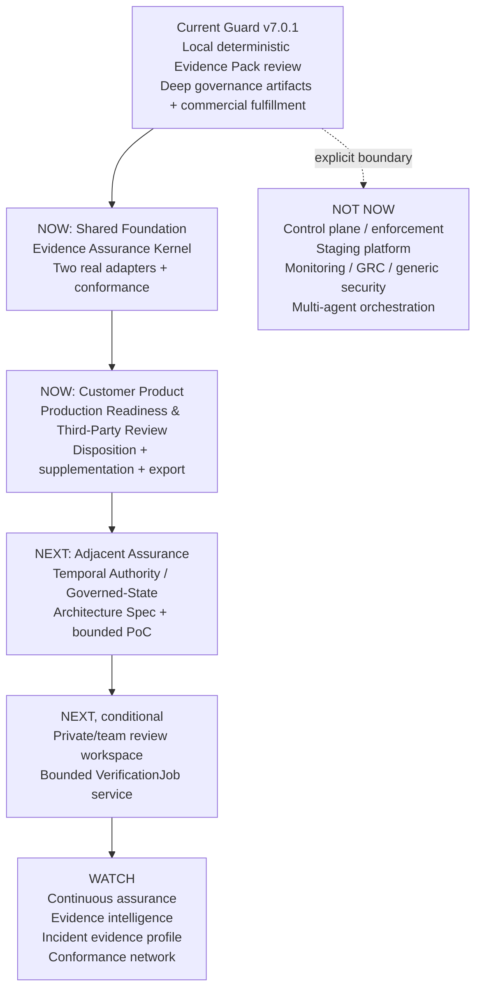

# MindForge Guard Next Strategic Directions Assessment v0.1

> Status: Final strategic assessment. Repository audited at `e861fb725ce9436e5e22735f0a88db7682b84b09` on 2026-08-27.
>
> Trace labels: **[Research]** external/reference-corpus claim; **[Repo]** repository-observed fact; **[Inference]** cross-source interpretation; **[Recommendation]** proposed action.

## 1. Executive Conclusion

**1. Do the recent sources require Guard to change its core direction?** No. The dominant evidence reinforces a deterministic, evidence-first, independently reviewable, producer-neutral, non-executing assurance layer. The corpus does not justify turning Guard into an Agent Control Plane, staging platform, monitoring platform, or generic GRC system. [Research][Repo][Inference]

**2. What is mostly reinforcement?** Provenance, integrity, missing evidence, independent verification, four-state uncertainty, human review, external evidence normalization, and the separation between evidence producers and governance interpretation all match implemented Guard assets and accepted repository boundaries. [Research][Repo]

**3. What is the genuinely new strategic opportunity?** The strongest new adjacency is **temporal, evidence-backed authority and governed-state assurance**: proving that actor, scope, delegation, policy, deployment, or other material state remained valid across a consequential action or transition. A second opportunity is to turn local external-evidence foundations into a repeatable readiness/third-party review product. [Inference]

**4. What are the largest actual capability gaps?** (a) assurance semantics beyond pack structure—source/verifier separation, admissibility, supportability, contradiction, and residual uncertainty; (b) live temporal evidence inputs beyond fixture-backed authority/transition previews; (c) a complete intake→review→supplement→disposition→export workflow; and (d) market proof that buyers will pay repeatedly. A production assurance service is also absent, but it is a later-stage gap, not the first build target. [Repo][Inference]

**5. What are the next 1–2 priorities?** **Primary customer-facing bet:** Production Readiness & Third-Party Evidence Review, built on a consolidated Evidence Assurance Kernel. **Secondary enabling bet:** a bounded Architecture Specification and PoC for Temporal Authority & Governed-State Assurance. [Recommendation]

**6. What should Guard avoid now?** Generic control-plane/runtime enforcement, owned approval, full observability/incident monitoring, Agent staging/simulation, generic GRC, generic AI security, multi-agent orchestration, hidden-CoT governance, and premature assurance-cloud infrastructure. [Recommendation]

**7. What should Guard become in the medium term?** A local/private-first **deterministic evidence assurance product for AI workflows**, able to review heterogeneous evidence for releases, third-party agents, and material changes; later, if recurring demand is proven, a bounded verification service supporting continuous assurance and enterprise evidence intelligence. [Recommendation]

The recommended strategy is layered rather than a single monolithic direction:

```text
Evidence Assurance Kernel
        ↓
Readiness & Third-Party Review Product
        ↓
Temporal Authority / State Assurance
        ↓
Bounded Verification Service (conditional)
        ↓
Continuous Assurance / Evidence Intelligence (conditional)
```

## 2. Repository Baseline

| Baseline item | Observed state |
|---|---|
| Repository | `D:\AI project\mindforge-guard` |
| Branch | `main` |
| HEAD | `e861fb725ce9436e5e22735f0a88db7682b84b09` |
| `origin/main` | `e861fb725ce9436e5e22735f0a88db7682b84b09` |
| Latest tag | `v7.0.1` |
| Guard package | `@veeduzyl/mindforge-guard@7.0.1` |
| Guard Core package | `@veeduzyl/mindforge-guard-core@0.1.0` (private) |
| Current public positioning | deterministic governance evidence layer for single-agent AI workflows |
| Working tree at start | clean |
| Remote sync action | none; repository was not pulled or changed |

The repository contains two overlapping lineages that must not be confused. [Repo]

1. The current public `v7.0.1` line exposes local CLI governance, Evidence Pack validation/reporting, drift analytics, offline licensing, and License Hub commercial fulfillment. [Repo]
2. A deep internal governance artifact lineage implements opt-in permit-gate and many receipt/decision/case artifacts, while later authority/admissibility/grounding/transition surfaces are explicitly fixture-backed previews. [Repo]

The README and accepted ADRs freeze the current boundary as deterministic, local-first, non-executing, recommendation-oriented, and non-control-plane. `Guard Core` is the governance source of truth; the Evidence Pack is the factual input; Harness, Renderer, Studio, SDK, and CLI are producer/consumer surfaces and may not become independent verdict engines. [Repo]

Representative verification completed during this audit: `npm run verify`; Outcome Foundation positive contract; v7.0 single-agent report and pack preview chains; v6.15-v6.20 authority/grounding/admissibility/guardrail/authority-drift/transition final acceptance; external evidence normalization, assurance report, composition, job envelope, and idempotency replay; and Studio prototype smoke. All invoked checks passed. [Repo]

## 3. Reference Corpus

The reference directory is `D:\decison assistant\Guard\近期参考文档`. It contains 20 DOCX files, all of which were parsed from their OOXML text without modifying the originals. [Research]

This corpus is not 20 independent market signals. Most documents are Guard-specific strategic translations of a smaller set of research, reports, practitioner essays, standards discussions, and enterprise cases. Their value is therefore highest as **hypothesis generators and convergence evidence**, not as 20 independent validations of product-market fit. [Inference]

The strongest source-backed clusters are: copyable-context safety limits; production-agent readiness; enterprise/board/UNDP governance; staging-to-runtime continuity; incident evidence quality; behavioral and deployment drift; and application-layer commercialization. The weakest evidence is where a source is a practitioner post, a preprint with narrow experiments, a successful-case sample, or an internal strategic synthesis that extends well beyond the cited source. [Research]

## 4. Cross-Document Strategic Signals

### 4.1 Signal consolidation matrix

| Strategic Signal | Supporting Docs | Frequency | Novelty | Strength | Signal Type | Guard Implication |
|---|---|---:|---|---|---|---|
| Independent evidence, provenance, integrity, verification, and explicit missing evidence | R01-R20 | 20 | Reinforcing | High | Reinforcing | Deepen assurance semantics and prove what each evidence item can support; do not merely add more fields. |
| Authority must be stateful, time-bound, scoped, and evidence-backed | R03, R05, R06, R08, R10-R13, R15-R17, R19-R20 | 14 | Capability extension | High | Capability-extension | Move from declared/static authority to verifiable authority state and transition evidence, while remaining non-executing. |
| External/cross-system evidence must be normalized without inheriting producer trust | R01-R04, R06, R09-R10, R12-R19 | 15 | Reinforcing/extension | High | Capability-extension | Prioritize adapter conformance, source trust, normalization, verification independence, and composition. |
| Behavioral, identity, memory, deployment, and delegation changes create temporal assurance needs | R01, R05-R08, R10-R12, R16, R19-R20 | 11 | New adjacent capability | Medium-High | Capability-extension | Validate bounded transition/continuity evidence before attempting broad behavioral compliance or monitoring. |
| Production readiness requires evidence sufficiency, independent outcome verification, recovery context, and release identity | R01, R03-R04, R06-R07, R10, R12, R15, R18-R19 | 10 | Reinforcing/packaging | High | Market-positioning | Package existing primitives into a repeatable readiness/third-party evidence review workflow before building a staging platform. |
| Staging-to-runtime continuity matters more than owning staging infrastructure | R01, R07, R10, R15, R19 | 5 | New adjacency | Medium | Capability-extension | Define release/deployment continuity receipts; treat staging systems as producers. |
| Incident evidence needs exposure, denominator, reporting-bias, reconstruction, and confidence context | R02, R04, R06, R08, R10, R17 | 6 | New specialized extension | Medium | Capability-extension | Run a narrow incident-evidence profile experiment; do not build an incident database or monitoring platform. |
| Enterprise governance demand centers on ownership, accountability, procurement, Shadow AI, and reviewability | R03-R06, R09-R10, R12-R15, R17-R20 | 14 | Reinforcing | Medium-High | Market-positioning | Produce role-appropriate, traceable assurance outputs and use assessment/review as a commercial wedge. |
| Cloud/service value comes from ingestion, review, collaboration, repeat verification, and organization-level evidence—not from taking execution control | R02-R04, R09, R12-R15, R18-R19 | 10 | Market extension | Medium | Market-positioning | Sequence service architecture after a validated review workflow and tenancy/data-boundary specification. |
| Recurring revenue requires a recurring governance event: release, evidence review, assurance cycle, vendor renewal, or incident reconstruction | R01-R04, R07, R09-R10, R12-R15, R17-R19 | 14 | Reinforcing | Medium | Market-positioning | Test willingness to pay for repeatable assurance events; technical completeness alone does not validate the thesis. |
| Open contract + protected verification/assurance may create ecosystem leverage | R01, R09, R12, R14-R16 | 6 | Potential discontinuity | Medium-Low | Potential strategic discontinuity | Watch interoperability and conformance; avoid prematurely declaring a standard or protocol category. |

### 4.2 Signal-family interpretation

- **Independent Evidence / Assurance:** the most frequent and strongest convergence signal. The genuinely new question is not whether Guard should be evidence-first, but whether it can express evidence trust, independence, sufficiency, admissibility, residual uncertainty, and decision effect in deterministic form. [Research][Inference]
- **Runtime / Authority:** sources repeatedly distinguish identity, declared permission, current authority, delegation, scope, and valid action. This is a plausible next-layer gap, but it does not justify turning Guard into IAM, approval infrastructure, or an enforcement control plane. [Research][Inference]
- **Behavioral Compliance:** the valuable kernel is temporal comparison of governed state and consequential behavior. The broad “runtime governance control loop” framing in R08 crosses Guard's current stated boundary and should be treated as an architecture-changing hypothesis, not inherited strategy. [Research][Inference]
- **External Evidence:** nearly universal support exists for producer-neutral ingestion, normalization, provenance retention, and independent verification. The strategic question is productization and trust semantics, not whether another schema should be invented. [Research][Inference]
- **Staging → Runtime:** a real adjacency, but the corpus consistently supports Guard as a verifier of staging/release evidence rather than an owner of simulation infrastructure. [Research]
- **Incident / Monitoring:** only a narrow new signal is supported: qualify incident evidence and express denominator/coverage/confidence. The evidence does not support building full monitoring, detection, or incident-response infrastructure. [Research][Inference]
- **Production Readiness:** strongly supported as a customer-facing packaging opportunity. Its technical novelty is lower than its product and commercial relevance. [Research][Inference]
- **Enterprise Governance:** strong demand narrative, but most evidence is qualitative or case-based. It supports buyer discovery and workflow design, not a claim of validated enterprise demand. [Research][Inference]
- **Cloud / Service:** plausible recurring-value layer, especially for review collaboration and repeat verification. R18 is the clearest contrary signal to concept expansion: it argues the nearer bottleneck may be converting existing assets into a complete review workflow. [Research]
- **Commercialization:** the corpus converges on readiness review, third-party evidence review, periodic assurance, and incident evidence packs. No document supplies direct MindForge Guard willingness-to-pay evidence. Commercial thesis remains unvalidated. [Research][Inference]

## 5. Reinforcing vs New Signals

### 5.1 Reinforcing signals

1. Guard should remain deterministic, evidence-first, independently reviewable, producer-neutral, non-executing, and outside the runtime control path. [Research]
2. Evidence must distinguish claims, observations, verification, provenance, integrity, missing evidence, and human judgment. [Research]
3. External systems should produce evidence; Guard should normalize, verify, compose, and explain it. [Research]
4. Four-state conclusions (`allow`, `block`, `require_review`, `inconclusive`) are more defensible than binary or score-only governance. [Research]
5. Enterprise value is strongest around consequential actions, production/release decisions, third-party assurance, audit readiness, and responsibility handoff. [Research]

### 5.2 Capability-extension signals

1. **Evidence-backed authority state:** validity windows, revocation, delegation, source, subject, scope, and action-time applicability. [Research]
2. **Temporal assurance:** compare baseline/candidate or previous/current governed states and identify material authority, behavior, memory, identity, deployment, or control changes. [Research]
3. **Evidence assurance semantics:** source trust, independence, copyability/replay risk, admissibility, residual uncertainty, and which conclusions evidence can support. [Research]
4. **Continuity receipts:** release identity, deployment attestation, runtime manifest, and mismatch/drift evidence across staging and production. [Research]
5. **Repeatable review workflow:** evidence ingestion, validation, reviewer disposition, supplementation, export, and repeat assurance. [Research]

### 5.3 Architecture-changing signals

- Runtime enforcement, approval ownership, behavior-control loops, and execution interruption would move Guard toward a control plane. R08 advocates part of this path, while most other documents explicitly preserve a non-executing boundary. This conflict must be resolved against repository reality, not source frequency. [Research][Inference]
- A multi-tenant cloud review/assurance service could change data, identity, persistence, tenancy, and operating-model assumptions. It is a service-architecture decision, not a natural consequence of having local verification jobs or service-shaped schemas. [Inference]

### 5.4 Market-positioning signals

- “Governance Evidence Layer,” “Evidence Review & Assurance,” and “Runtime Evidence & Decision Assurance” are closely related formulations, not three product categories. The stable category center is **independent deterministic assurance over AI-workflow evidence**. [Inference]
- Production-readiness and third-party evidence review appear to be the clearest initial purchase events. Continuous assurance may create recurring revenue later, but only after repeat ingestion and review value is validated. [Research][Inference]

### 5.5 Possible strategic discontinuities

Two signals could become discontinuities, but neither is yet proven:

1. **Evidence assurance interoperability/conformance** could make Guard a trusted verification layer across producers rather than a single CLI product. It requires real independent producers, stable semantics, conformance tests, and external adoption—not roadmap language. [Inference]
2. **Temporal authority assurance** could differentiate Guard from logging, GRC, and static evidence review by proving whether authority and governed state remained valid over time. It must first be demonstrated as a bounded, deterministic extension that does not take execution authority. [Inference]

## 6. Guard Current Capability Map

Status labels in this section describe repository reality, not market availability. `Implemented` means executable code exists for the bounded capability stated; it does not imply enterprise maturity. `Prototype` means executable but explicitly fixture-, preview-, local-spike-, or static-prototype-scoped. [Repo]

| Capability | Status | Repository Evidence | Maturity | Boundary / Missing Part |
|---|---|---|---|---|
| Policy validation and repository audit | Implemented | `packages/kernel/src/validatePolicy.mjs`, `packages/kernel/src/audit.mjs`, `packages/guard/src/runAudit.mjs`; `scripts/verify_governance_surface.mjs` | Released local CLI | Stable audit output/verdict/exit must remain unchanged. |
| Canonical action classification | Implemented | `packages/guard/src/cli/action.mjs`, `packages/guard/src/runtime/actions/*`; `scripts/verify_canonical_action_contract.mjs` | Released local CLI | Coding/repository action vocabulary; not a universal enterprise action ontology. |
| Drift status, timeline, and compare | Implemented | `packages/guard/src/runtime/drift/*`; CLI help exposes status/timeline/compare | Released, edition-gated depth | Signal analytics over Guard drift events; not autonomous-agent behavioral compliance. |
| Drift/risk association correlation | Implemented | `packages/guard/src/runtime/association/*`, `runGuard.mjs` | Released Pro+ analytic | Statistical signal only; does not establish causation or incident monitoring. |
| Evidence Contract v1 | Implemented | `packages/schema/evidence-schema-v1.json`, `packages/guard-core/src/parseEvidencePack.ts`, `validateEvidencePack.ts` | Concrete schema and validator | Many authority/identity fields remain declarations unless separately evidenced. |
| Evidence Pack parsing and validation | Implemented | `parseEvidencePack.ts`, `validateEvidencePack.ts`, `guard pack validate --preview`; v7.0 pack verifiers | Released preview surface | Local pack input; no remote ingestion or durable service boundary. |
| Evidence coverage and missing-evidence reasoning | Implemented | `inspectEvidenceCoverage.ts`, `reasonCodes.ts` | Deterministic core | Coverage is structural/pack-bounded, not proof of real-world completeness. |
| Four-state governance report | Implemented | `generateGovernanceReport.ts`, `reportModel.ts`; v7.0 final-acceptance verifier | Deterministic core/released preview | `allow` means structurally sufficient under current rules, not legal approval or safety certification. |
| Evidence index / traceability output | Implemented | `generateEvidenceIndex.ts`, examples and Studio workflow | Deterministic downstream artifact | Indexes submitted references; does not fetch or independently inspect every artifact. |
| Markdown and HTML report renderers | Implemented | `packages/renderer-md/src/renderMarkdownReport.ts`, `packages/renderer-html/src/renderHtmlReport.ts` | Concrete downstream renderers | Presentation-only; must not compute verdicts. |
| Source-pack provenance and deterministic hashing | Implemented | report provenance in `generateGovernanceReport.ts`; canonical hashes in Guard runtime/product modules | Multiple concrete paths | Hashes prove content identity/integrity within a boundary, not external authenticity. |
| Opt-in permit gate and governance artifact chain | Implemented | `runAudit.mjs --permit-gate`; `runtime/governance/permit/*`; governance verification scripts | Deep internal/stable artifact lineage | Not the current headline commercial surface; gate/enforcement terminology creates positioning tension and grants no business-execution authority. |
| Governance receipts, decisions, outcomes, applications, dispositions, activations, and case artifacts | Implemented | `packages/guard/src/runtime/governance/**`; v6.12 acceptance chain | Internally verified artifact family | Large artifact surface is not the same as a coherent current buyer workflow. |
| Static authority representation in Evidence Pack/report | Implemented | Evidence schema `authority`; validator; `AuthoritySummary` in report model | Concrete but declaration-sensitive | No identity proof or IAM; validity depends on submitted evidence. |
| Authority check and explanation | Prototype | `packages/guard/src/cli/authority.mjs`, `schemas/authority/*`, fixtures; v6.14/v6.15 verifiers | Fixture-backed preview | No live actor discovery, context capture, write path, or execution grant. |
| Authority drift / execution-time authority validity | Prototype | `authority.mjs`, `schemas/authority_drift/*`, fixtures; v6.18 final acceptance PASS | Fixture-backed deterministic preview | Demonstrates semantics, not live temporal observation or production authority continuity. |
| Admissibility and grounding explanation | Prototype | `cli/admissibility.mjs`, `cli/grounding.mjs`, schemas/fixtures; v6.16/v6.17 acceptance | Fixture-backed preview | Explanation-only; not a production intake gate or source-fetching verifier. |
| Symbolic guardrail mapping | Prototype | `cli/guardrail.mjs`, `schemas/guardrail_mapping/*`; v6.19 acceptance | Fixture-backed preview | Mapping/explanation only; not runtime enforcement. |
| Execution-bound transition validity | Prototype | `cli/transition.mjs`, transition schema/fixture; v6.20 final acceptance PASS | Fixture-backed deterministic summary | Explicitly does not prove state equivalence or create commit/permit/deployment gates. |
| Procedural artifact receipt and lineage trajectory | Prototype | `schemas/procedural_artifact_receipt/*`, `schemas/procedural_lineage_trajectory/*`, fixtures and v6.21/v6.22 verifiers | Preview artifact line | Procedural/coding scope; not general production lineage service. |
| General identity evolution and delegation propagation | Absent | No stable source/runtime model found; auth/tenant assessment explicitly says no actor-chain/delegation source contract | Not implemented | Static actor/authority fields and preview fixtures do not provide identity lifecycle or delegation graph. |
| Behavioral state, memory-change assurance, and broad behavioral drift | Absent | No general previous/current behavioral or memory contract/engine found | Not implemented | Existing drift is repository/governance signal analytics; transition preview is fixture-declared. |
| External Evidence Source Adapter contract | Partial | `externalEvidence/types.ts` defines `EvidenceSourceAdapter` and normalized record | Type contract + local fixture ecosystem | No general production adapter runtime/SDK export. |
| External evidence normalization | Prototype | `localDeclarativeNormalizationFixture.mjs`; normalization verifier PASS | Local declarative fixture | Source-declared identity/integrity may be copied, explicitly not independently verified. |
| Findings taxonomy for external evidence | Partial | `types.ts`, `docs/verification-findings-taxonomy-v0.1.md` | Contract/document foundation | No generic production findings engine across adapters. |
| Reference adapter (Ramen receipt v5) | Prototype | `referenceAdapters/ramenReceiptV5/localSpike.mjs`, mapping/readiness docs | One local spike | One issuer; non-privileged, non-production, not a complete adapter framework. |
| Adapter registry and manifest selection | Prototype | `registryTypes.ts`, `localAdapterManifestSelectionFixture.mjs`, verifier | Review/type + local selection fixture | No production onboarding, discovery, trust registry, or service selection policy. |
| Local external assurance report composition | Prototype | `localAssuranceReportFixture.mjs`, `local_external_evidence_assurance_composition.mjs`; verifiers PASS | Local-only deterministic composition | Non-exported/non-networked/non-persistent; not a production service. |
| External assurance report integrity | Partial | `localAssuranceReportIntegrity.mjs`; canonical SHA-256 checks and negative tests | Strong local implementation | Integrity does not establish issuer authenticity, non-repudiation, or real-world truth. |
| Verification job/attempt/result/usage/idempotency artifacts | Prototype | `verificationTypes.ts`, local job/usage/idempotency fixtures; verifiers PASS | Type contracts + local fixtures | No durable job runner, retry worker, or operational service. |
| Minimal assurance service API contract | Spec-only | `minimalServiceApiTypes.ts`, `external-evidence-assurance-minimal-service-api-proposal-v0.1.md` | Type/proposal only | No HTTP route or transport implementation for assurance jobs. |
| Assurance-service persistence | Absent | No verification-job/report models in `packages/db/prisma/schema.prisma` | Not implemented | Existing database is License Hub commerce/account data only. |
| Assurance-service queue/workers | Absent | No queue or worker path found | Not implemented | Local fixture lifecycle is not asynchronous processing. |
| Assurance-service authentication and tenant isolation | Absent | No assurance auth/tenant runtime; assessment documents defer it | Not implemented | License Hub auth/org models cannot be treated as assurance-service tenancy. |
| Studio review workspace | Prototype | `prototypes/studio/*`, `docs/studio-prototype.md`; smoke PASS | Static/local prototype | Browser-to-Guard handoff remains bounded/local; no hosted collaboration, persistence, or approval workflow. |
| Agent staging/simulation product | Absent | Only release checklists, fixtures, experiments, and Studio prototype found | Not implemented | Tests and Studio are not a staging environment. |
| Incident monitoring/anomaly-response product | Absent | No incident store, detector, exposure model, alerting, response workflow, or continuous monitor found | Not implemented | Existing evidence can support later investigation; it is not incident monitoring. |
| Evidence replay and historical comparison | Partial | drift compare; governance evidence replay profiles; external idempotency replay fixture | Several bounded paths | No unified historical evidence store or cross-run temporal assurance engine. |
| Offline signed licensing and edition gating | Implemented | `packages/licensing/*`, `packages/guard/src/product/license*`, CLI license commands | Released commercial core | Commercial access only; editions do not add runtime authority. |
| License Hub purchase, webhook, signed-license delivery, portal and admin lifecycle | Implemented | `apps/license-hub/app/api/**`, `lib/paddle*`, `lib/billing*`, `lib/issueLicenseForPaidOrder.ts`, Prisma models | Concrete hosted commercial system | This is commerce/fulfillment, not Guard assurance cloud. Live deployment was not independently tested in this audit. |
| Organization, seats, and online activation | Partial | Prisma Organization/Member/Seat/Activation models and API routes; capability baseline calls some surfaces bounded skeletons | Bounded commercial skeleton/partial surface | Not assurance RBAC, SSO, SCIM, or multi-tenant governance workspace. |
| Public Guard SDK | Roadmap-only | Guard Core has private exports; product boundary says SDK alpha is later | Internal API foundation only | No published stable SDK product or hosted API. |
| Multi-agent orchestration/governance | Absent | Explicit non-goal in ADRs/boundary; no orchestrator implementation | Not implemented | Handoff references/artifacts must not be misread as orchestration. |

### 6.1 Capability reality summary

Guard's strongest real asset is a deterministic local **Evidence Pack → coverage/reasoning → four-state report → traceable output** chain, supported by a much deeper internal governance-artifact lineage and commercial license fulfillment. [Repo]

Its most strategically relevant adjacent foundations are fixture-backed authority drift/transition semantics and the local external-evidence assurance composition. [Repo][Inference]

Its largest reality gaps are not “more schema fields.” They are: evidence trust/admissibility beyond pack structure; live temporal evidence production; a repeatable end-user review workflow; and—only if validated—a durable multi-user assurance service boundary. [Inference]

## 7. Research-to-Guard Gap Matrix

| External Signal | Proposed Capability | Guard Reality | Actual Gap | Classification | Priority |
|---|---|---|---|---|---|
| Evidence must separate claims, observations, verification, provenance, and missing evidence | Evidence assurance semantics | Evidence Contract, trust model, coverage, reason codes, four-state report exist | Stable trust/admissibility/independence semantics that specify what evidence can support and residual uncertainty | Foundation Exists | P0 |
| Context is copyable and cannot prove authority | Verified external assertions and trust boundary | Pack fields can be declared; external local normalizer explicitly copies some unverified declarations | Bind high-consequence assertions to verifier identity, method, object/scope, validity, and limitations | Foundation Exists | P0 |
| External runtime evidence should be portable and producer-neutral | Adapter conformance and normalization | Type contracts, normalized record, registry types, one spike, local selection/composition fixtures exist | At least two independent real producers, stable conformance tests, generic verification execution, and end-user ingestion | Foundation Exists | P0 |
| Authority is stateful and time-bound | Authority-state assurance | Static authority fields plus fixture-backed check/explain/drift semantics exist | Live evidence inputs and deterministic previous/current authority validity without IAM or execution control | Foundation Exists | P0 bounded architecture/PoC |
| Behavioral compliance is temporal | Governed-state transition assurance | Generic drift analytics and fixture-declared transition preview exist | A minimal, evidence-defined state-transition object and material-change semantics; no broad behavior platform | New Capability Gap | P1 after P0 experiment |
| Identity/delegation can evolve and propagate | Identity/delegation transition evidence | No stable actor-chain/delegation lifecycle contract | Producer-neutral identity/delegation receipts and bounded propagation rules | New Capability Gap | P1/WATCH |
| Production readiness needs independent outcome and evidence sufficiency | Readiness assurance product | Core report/coverage exists; release/rollback reason codes exist; no complete customer workflow | A repeatable intake→review→supplement→decision-export product with scenario profile and acceptance criteria | Foundation Exists | P0 |
| Third-party agents need independent evidence review | Third-party evidence review | External local assurance foundation and report core exist | Real third-party pack ingestion, adapter trust, reviewer workflow, and pilot evidence | Foundation Exists | P0 |
| Staging is required before production | Agent staging platform | No staging/simulation product | None for Guard; consume staging receipts instead | Out of Current Boundary | DO NOT BUILD |
| Staging evidence must continue into deployment/runtime | Release/deployment continuity receipt | Transition/lineage/receipt primitives exist in bounded forms | Release identity, deployment attestation, and runtime-manifest comparison backed by external producer evidence | Foundation Exists | P1 |
| Incident trends require exposure and reporting context | Incident evidence qualification | No incident profile/denominator model; general evidence and findings primitives exist | Narrow profile for source, denominator, coverage, duplicate linkage, confidence, contrary evidence | New Capability Gap | WATCH / bounded research |
| Enterprises need continuous incident monitoring | Monitoring/alerting/response platform | No incident store, detector, alerting, or response runtime | This is a separate category and operating model | Out of Current Boundary | DO NOT BUILD |
| Deployment/model changes can alter consequential behavior | Risk-weighted baseline/candidate comparison | Drift compare and transition preview exist; no deployment evidence profile | Deployment provenance plus bounded action/authority/result comparison | Foundation Exists | P1 |
| Decisions need external reasoning evidence, not hidden CoT | Evidence-policy-state-decision linkage | Governance decision/receipt/provenance artifacts exist | Simplified external decision-basis references and applicability/version evidence | Foundation Exists | P2/WATCH |
| Enterprise governance requires owners, reviewers, approvals, and accountability | Review/sign-off workflow | Human-review requirements and deep governance case/decision artifact lineage exist | Coherent current user workflow, role presentation, reviewer disposition, and customer validation | Foundation Exists | P0 productization |
| Organizations want dashboards and portfolio views | Review workspace and organization view | Static local Studio prototype; License Hub organization skeleton | Usable review workspace and collaboration—not a dashboard-first control plane | Foundation Exists | P0 local/controlled workflow; cloud later |
| Cloud enables recurring assurance | Bounded assurance service | Service-shaped types/proposals; no API, persistence, queue, assurance tenancy/auth | Durable job/report service, security/data boundary, operations, and validated recurring use | New Capability Gap | P1 only after workflow/market validation |
| Enterprise GRC demand is growing | Full GRC platform | Guard produces evidence/recommendations only | Policy libraries, controls management, regulatory mapping, attestations, enterprise workflows would be a different product | Out of Current Boundary | DO NOT BUILD |
| Agent control planes are expanding | Runtime enforcement/approval/control | Guard is non-executing; opt-in legacy permit artifacts exist but no business-action runtime | Taking execution authority would alter category and core invariants | Out of Current Boundary | DO NOT BUILD |
| Multi-agent fleets increase accountability complexity | Multi-agent orchestration/governance | Explicit non-goal; no orchestrator | Bounded handoff evidence may be adjacent; fleet control is outside boundary | Out of Current Boundary | WATCH evidence only |
| Open protocols may capture evidence semantics | Interoperability/conformance | Openable contracts, registry types, verification tests; no external adoption proof | Real adapter/conformance proof and governance of semantic versions | Foundation Exists | P1/WATCH |
| Commercial value comes from recurring assurance events | Paid readiness/review/assurance offers | Editions, licensing, purchase fulfillment exist; no Guard-specific willingness-to-pay evidence in corpus/repo | Design-partner discovery, paid pilot, baseline ROI, repeat-event retention proof | Insufficient Evidence | P0 market validation |

### 7.1 Direct answers to the research-to-reality questions

**Which external views mainly reinforce the existing route?** Independent evidence, provenance, four-state uncertainty, producer-neutral normalization, human review, non-executing boundaries, and buyer interest in consequential workflows all reinforce the implemented kernel and accepted ADRs. [Research][Repo]

**Which areas have a foundation but are missing the next layer?** The top three are (1) external-evidence assurance beyond local fixtures, (2) authority/transition semantics beyond fixture-backed preview, and (3) a complete review workflow beyond CLI output and a static Studio prototype. [Repo][Inference]

**Which are genuinely new gaps?** Live evidence-backed authority continuity; a bounded governed-state transition model; production-quality assurance ingestion/service only if later validated; and specialized incident evidence qualification. [Inference]

**Which important capabilities should Guard not implement itself?** Agent staging/simulation, IAM, runtime orchestration/enforcement, full incident monitoring, generic observability, full GRC, model compression/evaluation engines, and business workflow execution. Guard should consume evidence from them. [Recommendation]

**Which prior-roadmap suggestions are already complete?** Action classification; four-state governance verdict; explainable reason codes; missing-evidence coverage; core Evidence Contract fields; local single-agent report; evidence index/renderers; offline edition gating; much of the governance receipt/decision artifact chain; and fixture-backed authority, grounding, admissibility, guardrail, authority-drift, and transition preview semantics. [Repo]

**Which roadmap ideas reappear under new names?** “Runtime assurance,” “behavioral compliance,” “production readiness,” “decision confidence,” “control coverage,” and “reasoning governance” repeatedly restate the need to connect evidence, authority/policy, consequential action, verification, uncertainty, and human review. They are profiles or extensions of one assurance kernel, not separate platforms. [Inference]

## 8. Strategic Kernel

| Kernel Principle | Support | Repository Evidence | Assessment |
|---|---|---|---|
| Deterministic | Strongly Supported | canonical action/hash modules; deterministic Guard Core report logic; external report canonicalization; repeated-output verifiers | Determinism is one of the clearest implementation-level strengths. |
| Evidence-first | Strongly Supported | Evidence Pack as sole factual input; Guard Core coverage, missing-evidence and report model | Strong in architecture and code, though pack contents can still be declared/unverified. |
| Independent verification | Supported | producer/Guard separation; External Evidence adapter and integrity line | Independence is structurally supported, but generic third-party verification, trust registry, and production adapters are incomplete. |
| Provenance | Supported | Evidence Contract provenance/manifest; report source-pack hash; external raw-evidence references | Concrete lineage exists, but external identity/authenticity remains limited. |
| Reproducibility | Strongly Supported | fixture-backed verification, deterministic hashes, idempotency/replay tests | Strong locally; not yet proven across a service/runtime fleet. |
| Reviewability | Strongly Supported | four-state report, reason codes, missing evidence, Markdown/HTML, Evidence Index, Studio prototype | Review artifacts are rich; the complete collaborative review workflow is not yet productized. |
| Vendor neutrality | Supported | cross-runtime Evidence Pack, adapter interfaces, producer-neutral contracts | Architecture supports neutrality; only one narrow reference-adapter spike limits proof. |
| Non-executing | Strongly Supported | ADR 0003; no agent/tool/deployment execution in Guard Core/Studio/external assurance path | Opt-in permit-gate can return deny semantics, but Guard itself still does not execute business actions. |
| Additive | Strongly Supported | preview/default-off command families and compatibility verifiers | Extensive compatibility discipline is visible in code and tests. |
| Recommendation-oriented | Mixed | current public docs and previews state recommendation-only; `--permit-gate` and enforcement-adjacent internal line exist | Current positioning is recommendation-oriented, but legacy/internal gate terminology and exit semantics require careful boundary explanation. |
| Local-first | Strongly Supported | local CLI, offline license, local Guard Core, local Studio/external fixtures | License Hub is hosted for commerce, not required for local governance verdicts. |

The strategic kernel is real, not merely aspirational. The main caveat is that **independence currently stops at the submitted/local evidence boundary more often than the marketing phrase “independent assurance” might imply**. [Repo][Inference]

## 9. Capability Interpretation Risks

### Feature inflation

The corpus uses at least six vocabularies for substantially the same chain: evidence assurance, runtime assurance, production readiness, behavioral compliance, decision confidence, and governance evidence infrastructure. Treating each as a module would recreate the same source/provenance/authority/verification/review concepts repeatedly. [Research][Inference]

**Control:** define one shared assurance kernel and require every profile to reuse its objects and reason semantics. [Recommendation]

### Control-plane drift

R08 and some legacy repository terms (`permit_gate`, enforcement pilots) can pull the product toward execution authority. The accepted current boundary says Guard does not approve, block, deploy, or control business execution. [Research][Repo]

**Control:** preserve non-executing outputs; let external systems decide how to consume `allow/block/require_review/inconclusive` or verification findings. Do not add approval/execution APIs to the assurance service line. [Recommendation]

### Monitoring inflation

Drift timelines, evidence replay, and incident reconstruction usefulness do not constitute continuous incident monitoring. There is no detector, alert pipeline, incident store, exposure model, or response system. [Repo]

**Control:** if explored, build only an Incident Evidence Profile and qualification report; integrate with SIEM/observability/incident systems as evidence producers. [Recommendation]

### Staging inflation

Fixtures, experiments, release checklists, and Studio do not initialize isolated environments, execute scenarios, reset state, or promote builds. [Repo]

**Control:** define staging receipts and continuity checks; do not build simulation infrastructure. [Recommendation]

### Compliance inflation

Deterministic evidence validation and a governance verdict do not establish legal compliance, certification, or universal safety. Current report `allow` is based largely on structural sufficiency and bounded rule logic. [Repo]

**Control:** use “verified / not verified / incomplete / requires review” for external assurance; keep regulatory interpretations in separately versioned profiles with human responsibility. [Recommendation]

### Cloud inflation

`VerificationJob`, `AssuranceReport`, minimal-service types, and License Hub do not equal an assurance SaaS. The assurance line has no HTTP implementation, durable job persistence, queue, worker, auth, or tenant isolation. [Repo]

**Control:** validate the repeat review workflow and paid recurrence before architecture specification for a hosted service; never reuse commerce tenancy by assumption. [Recommendation]

### Maturity inflation

The repository has unusually extensive schemas, fixtures, acceptance scripts, and documentation. This can make a fixture-backed preview look production-ready. [Repo][Inference]

**Control:** require a maturity claim to name the actual input path, consumer, runtime, persistence, operational owner, and external user evidence. [Recommendation]

### Commercial inflation

Implemented licensing and payment fulfillment prove Guard can sell access; they do not prove buyers value readiness review or continuous assurance. [Repo]

**Control:** separate “commerce capability implemented” from “commercial thesis validated,” and make a paid design-partner signal an explicit gate. [Recommendation]

## 10. Candidate Strategic Directions

### Direction A — Evidence Assurance Kernel

**Strategic thesis.** Guard becomes the deterministic assurance kernel that states which submitted evidence is claimed, observed, independently verified, admissible for a profile, conflicting, missing, or unable to support a requested conclusion. [Recommendation]

**Customer problem / buyer.** AI platform, security, governance, audit, and engineering teams cannot defend decisions when evidence from different producers has inconsistent provenance, trust, verification methods, and limitations.

**Existing assets.** Evidence Contract; Guard Core parser/validator/coverage/report; reason codes; external normalized record; local assurance composition; report integrity; adapter types. [Repo]

**Missing foundations and core capabilities.** A bounded Evidence Assertion/Assurance Envelope; verifier identity/method/scope; source-vs-verifier separation; evidence support/admissibility semantics; contradiction and residual-uncertainty handling; two real producer adapters; conformance fixtures; a stable assurance profile contract.

**Architecture impact:** Moderate. Mostly additive to Guard Core/external-evidence contracts, but it must consolidate—not duplicate—the current report and local assurance lines.

**Boundary impact:** Strengthens the existing non-executing, independent boundary.

**Differentiation.** Observability records events; GRC records obligations; guardrails filter or enforce; Guard would state whether evidence is sufficient and independently supportable for a bounded governance conclusion.

**Commercial model / recurring value.** Free/open base contract plus Pro/Enterprise assurance profiles, SDK/CLI verification, conformance, and later usage-based verification. Every new evidence pack, release, supplier review, or assurance cycle creates repeat value.

**Risks.** Schema over-engineering; two overlapping report models; weak developer experience; independence claims exceeding actual verifier trust; category remaining too abstract without a customer workflow.

### Direction B — Temporal Authority & Governed-State Assurance

**Strategic thesis.** Guard proves whether authority and other governed state remained valid across time or a consequential transition, without owning identity, approval, or execution. [Recommendation]

**Customer problem / buyer.** Platform engineering, security, AI governance, and risk teams need to know whether the actor, scope, delegation, deployment, policy, or evidence changed between approval and action.

**Existing assets.** Static authority fields/report; authority check/explain/drift previews; transition validity preview; drift compare; governance receipts/lineage. [Repo]

**Missing foundations and core capabilities.** A canonical governed-state snapshot; previous/current comparison; event-time validity; material-change taxonomy; producer-neutral authority/delegation receipts; evidence-decay and revocation semantics; one live producer pilot.

**Architecture impact:** Moderate. It adds temporal inputs and comparison logic but can remain outside the execution path.

**Boundary impact:** Safe only if Guard verifies supplied state transitions and never becomes IAM, policy authority, or the component that stops/executes actions.

**Differentiation.** Static GRC and logs rarely prove action-time authority continuity. Agent control planes may enforce, but Guard can independently verify and explain the evidence afterward or beside the path.

**Commercial model / recurring value.** Enterprise assurance profile priced by governed workflow, release/change event, or periodic comparison. Recurrence comes from every authority/deployment/policy transition.

**Risks.** Live evidence acquisition complexity; identity-provider dependence; semantic disputes over authority; control-plane confusion; excessive abstraction before real cases.

### Direction C — Production Readiness & Third-Party Evidence Review

**Strategic thesis.** Guard becomes a repeatable evidence-backed review product for deciding whether an AI workflow or third-party agent has supplied enough trustworthy evidence for production use or renewal—while the human/enterprise remains the decision authority. [Recommendation]

**Customer problem / buyer.** AI platform owners, security, procurement, governance, and engineering leaders lack a defensible, efficient process for reviewing agent releases and supplier evidence packs.

**Existing assets.** Evidence Pack/report/index/renderers; release/rollback/authority reason codes; examples/templates; local Studio prototype; external evidence foundation; commercial fulfillment. [Repo]

**Missing foundations and core capabilities.** A versioned readiness/third-party review profile; intake and validation; reviewer disposition/rationale; evidence supplementation; comparison between submissions; exportable decision packet; two to five design-partner cases; outcome/ROI baseline.

**Architecture impact:** Moderate. It productizes existing assets and uses Direction A semantics; an initial local/controlled deployment avoids service complexity.

**Boundary impact:** Preserves non-executing behavior if outputs remain assurance findings/recommendations and the customer owns approval.

**Differentiation.** Evaluation platforms score model/agent performance; security tools detect threats; GRC manages obligations. Guard would produce an independently traceable sufficiency-and-boundary review packet across heterogeneous evidence.

**Commercial model / recurring value.** Paid assessment/pilot leading to Pro+/Enterprise software; per agent, supplier, release, or review cycle; optional implementation/assurance service. Recurrence comes from releases, renewals, material changes, and evidence supplementation.

**Risks.** Buyer workflow ambiguity; manual-service dependence; report value without strong independent evidence; “production ready” being misread as certification; limited willingness to pay.

### Direction D — External Evidence Assurance Service / Cloud

**Strategic thesis.** Guard becomes a bounded verification-job service for submitting evidence packages, running deterministic assurance profiles, and retrieving results/reports—never an execution control plane. [Recommendation]

**Customer problem / buyer.** Platform teams need repeat verification, integration, central review, history, and operational reliability that a local CLI alone cannot supply.

**Existing assets.** VerificationJob/Attempt/Result/Usage types; local deterministic fixtures; report integrity; minimal service API types; License Hub commerce/account system. [Repo]

**Missing foundations and core capabilities.** Service architecture specification; HTTP transport; immutable accepted-package semantics; persistence; queue/workers; auth; assurance-specific tenancy; resource limits; secrets/key handling; observability; retention/deletion; threat model; SLOs; deployment and operations.

**Architecture impact:** Major.

**Boundary impact:** Can preserve non-executing assurance, but centralization introduces data, trust, availability, and platform-positioning risk. License Hub tenancy must not be reused by assumption.

**Differentiation.** A verification service, not an observability/control plane: bounded deterministic job in, assurance artifacts out.

**Commercial model / recurring value.** Platform fee plus verification jobs, governed assets, retention, private deployment, and enterprise support. Repeated jobs and retained comparison history create recurrence.

**Risks.** Premature cloud complexity; security/tenancy failures; high operational burden; weak job volume; commoditization; building infrastructure before a paid workflow exists.

### Direction E — Enterprise Evidence Intelligence & Governance Workflow

**Strategic thesis.** Guard becomes an organization-level system for reviewing, comparing, routing, retaining, and learning from governance evidence across AI initiatives. [Recommendation]

**Customer problem / buyer.** AI governance, compliance, risk, security leadership, and CIO organizations need portfolio visibility, ownership, review history, and reusable evidence expectations.

**Existing assets.** Governance case/decision/attestation/closure artifact lineage; reports/indexes; Studio prototype; License Hub organization/seat skeleton. [Repo]

**Missing foundations and core capabilities.** Assurance-specific projects/tenants/roles; review assignments and dispositions; retention; comparison/history; evidence requirement templates; portfolio aggregation; governed feedback; enterprise integration and permissions.

**Architecture impact:** Major.

**Boundary impact:** High risk of dashboard-first and generic-GRC drift. The product must remain evidence-centered and consume Guard Core output rather than independently scoring compliance.

**Differentiation.** Evidence intelligence over execution artifacts rather than generic policy/control libraries.

**Commercial model / recurring value.** Annual Enterprise subscription by organization/governed assets, private deployment, connectors, retention, and support. Review history and standardized evidence requirements drive retention/expansion.

**Risks.** Crowded GRC/workflow market; buyer ambiguity; RBAC/integration burden; long sales cycles; product surface much larger than the evidence kernel.

### Direction F — Incident Evidence & Continuous Risk Assurance

**Strategic thesis.** Guard qualifies incident and exposure evidence and periodically produces defensible risk-trajectory findings, without becoming the detector, incident database, or response platform. [Recommendation]

**Customer problem / buyer.** Security, risk, incident response, and AI governance teams struggle to reconstruct events and avoid false trend claims from incomplete reporting or missing denominators.

**Existing assets.** Evidence/provenance/coverage, reason codes, drift timelines/compare, replay and lineage artifacts. [Repo]

**Missing foundations and core capabilities.** Incident evidence profile; exposure/denominator context; duplicate/causal linkage; contrary evidence; confidence rationale; connectors to existing incident/SIEM systems; repeat-period comparison.

**Architecture impact:** Moderate to Major depending on whether Guard remains a profile or accumulates monitoring infrastructure.

**Boundary impact:** A narrow evidence profile fits; detection, alerting, response, or a monitoring data platform does not.

**Differentiation.** Evidence qualification and defensible trajectory explanation rather than alert volume or incident response orchestration.

**Commercial model / recurring value.** Incident evidence packs, periodic assurance reports, or an Enterprise add-on. Recurrence depends on enough events/exposure data and credible ongoing comparisons.

**Risks.** Sparse/biased data; causal overclaiming; crowded security/observability market; strong pull toward monitoring platform scope; lower immediate fit with current users.

## 11. Strategic Direction Comparison

Scores are weighted points out of the criterion maximums shown in the prompt. They reflect current repository position and this corpus, not market-validated demand. [Inference]

| Direction | Architecture Fit /20 | Urgency /15 | Differentiation /15 | Reuse /10 | Evidence /10 | Commercial /10 | Moat /10 | Feasibility /5 | Risk /5 | Total /100 |
|---|---:|---:|---:|---:|---:|---:|---:|---:|---:|---:|
| A. Evidence Assurance Kernel | 20 | 13 | 14 | 10 | 10 | 7 | 9 | 5 | 5 | **93** |
| C. Production Readiness & Third-Party Review | 18 | 14 | 12 | 9 | 9 | 9 | 8 | 4 | 4 | **87** |
| B. Temporal Authority & Governed-State Assurance | 17 | 11 | 14 | 8 | 9 | 7 | 9 | 3 | 4 | **82** |
| D. External Assurance Service / Cloud | 13 | 11 | 10 | 7 | 8 | 9 | 7 | 2 | 2 | **69** |
| E. Enterprise Evidence Intelligence | 13 | 10 | 9 | 6 | 8 | 8 | 6 | 2 | 2 | **64** |
| F. Incident Evidence & Continuous Risk | 10 | 8 | 8 | 5 | 6 | 6 | 5 | 2 | 2 | **52** |

Direction A leads because it is the shared technical moat and directly closes the gap between “pack structure validated” and “assurance claim defensible.” Its lower commercial score reflects that a kernel is not a complete purchase event. [Inference]

Direction C is the strongest customer-facing bet because it packages the most existing capability around a concrete recurring decision. Its evidence and commercial scores are below certainty because no paid customer proof appears in the corpus or repository. [Inference]

Direction B is the strongest differentiated adjacency but scores lower on urgency/feasibility because current semantics are fixture-backed and live authority evidence depends on external systems. [Inference]

Direction D has meaningful recurring-revenue potential but loses on architecture fit, feasibility, and risk: the repository itself documents missing API, persistence, async, auth, tenancy, and operational security. [Repo]

Directions E and F may become valuable extensions; both currently create more category and architecture risk than the evidence justifies. [Inference]

## 12. Product Category Comparison

| Category | Near-term Fit | Differentiation | Boundary Risk | Assessment |
|---|---|---|---|---|
| Governance Evidence | High | Medium | Low | Accurate description of current assets, but can sound passive/report-only. |
| Agent / AI Workflow Evidence Assurance | **Very High** | **High** | Low | Best near-term category: adds verification/sufficiency meaning without claiming control. |
| AI Runtime Assurance | High, later | High | Medium | Strong medium-term category if “runtime” means evidence over actual execution, not runtime control. |
| Agent Assurance | Medium-High | Medium-High | Medium | Buyer-friendly but broad; requires clear scope around workflows and evidence. |
| Continuous Compliance | Low now | Medium | High | Overstates legal/compliance and monitoring capabilities. |
| AI Governance Infrastructure | Medium later | Medium | High | Too broad before external adoption and service proof. |
| Evidence Intelligence | Medium later | Medium-High | Medium-High | Plausible enterprise layer after history/portfolio data exists; premature now. |

**Category conclusion:** position the next product as **deterministic evidence assurance for AI workflows/agents**. Use “Governance Evidence Layer” as architecture language and reserve “AI Runtime Assurance” for the medium-term capability category once live cross-system evidence and temporal continuity are proven. [Recommendation]

## 13. Business Model Comparison

| Business Model | Fit Now | Recurring Event | Key Dependency | Recommendation |
|---|---|---|---|---|
| Local tooling / CLI | High | Every pack/release/review | Better workflow and profiles | Keep as trust root and adoption surface. |
| Paid assessment / design-partner service | **Very High** | New agent, supplier, release, renewal | Buyer discovery and repeatable method | Use now to validate purchase event and collect real evidence packs. |
| Enterprise software (local/private) | High-near | Reviews, releases, policy/evidence changes | Usable review workspace and team workflow | Build after profile/workflow validation; preserves data control. |
| Verification service | Medium-later | Verification jobs and repeat assurance | Service architecture, security, tenancy, volume | Do next only after paid recurrence is visible. |
| Continuous assurance | Medium-later | Periodic/runtime evidence cycles | Live producers, temporal model, history | Target as expansion, not initial product claim. |
| Evidence intelligence | Low-medium later | Portfolio review and benchmark cycles | Accumulated normalized history and permissions | Watch; data advantage does not yet exist. |
| Generic governance workflow/GRC | Low | Policies/audits | Broad workflow/control catalog | Do not pursue as a standalone category. |

The most coherent business sequence is **local deterministic trust root → paid readiness/third-party review → private/team review software → bounded verification service → continuous assurance/evidence intelligence**. Each transition should be gated by a recurring customer event, not by technical readiness alone. [Recommendation]

## 14. Recommended Portfolio

The right answer is a **layered core + customer product + bounded adjacency**, not six parallel product lines. [Recommendation]

### DO NOW

1. **Consolidate an Evidence Assurance Kernel v0.1.** Freeze source/claim/observation/verification roles, verifier method and scope, evidence support/admissibility, contradiction, missing evidence, and residual uncertainty. Reconcile the current Guard Core report and external Assurance Report semantics instead of creating a third model. [Recommendation]
2. **Create a real adapter-conformance boundary.** Connect at least two independent evidence producers, retain raw traceability, exercise generic findings/verification, and prove deterministic re-verification. One must not be the Ramen reference spike. [Recommendation]
3. **Productize one end-to-end review flow.** Build a bounded local/private intake→validate→assure→human disposition→request supplementation→compare→export flow for Production Readiness and Third-Party Evidence Review. Keep approval authority with the customer. [Recommendation]
4. **Specify and PoC temporal authority/state assurance.** Use one real producer to compare approval-time and action-time state, including scope, validity window, revocation/evidence decay, and material-change reasons. The PoC must remain non-executing and must not create IAM or enforcement behavior. [Recommendation]

### DO NEXT

1. Turn the validated review flow into a private/team review workspace with bounded projects, reviewers, dispositions, history, and retention.
2. Add release/deployment continuity as a profile over the same temporal assurance kernel.
3. Publish a bounded SDK/conformance surface only after two real producers prove the object model.
4. Write an assurance-service Architecture Specification only after repeat paid use is observed; then implement the smallest submit/status/result/report job boundary.

### WATCH

1. Incident Evidence Profile with exposure, denominator, coverage, and contrary-evidence semantics.
2. APAAI and adjacent interoperability/conformance standards; prioritize adapters and semantic mapping over protocol-brand competition.
3. Multi-agent handoff/delegation evidence, without fleet orchestration.
4. Evidence intelligence and cross-customer benchmarks, subject to privacy, permission, and sufficient normalized history.
5. Regulatory/industry assurance profiles maintained as versioned interpretations, not hard-coded compliance truth.

### DO NOT DO

1. Do not become a generic Agent Control Plane, execution runtime, or owned approval/enforcement authority.
2. Do not build Agent staging/simulation infrastructure; consume its receipts.
3. Do not build full observability, incident monitoring, SIEM, or response orchestration.
4. Do not become generic GRC or generic AI security.
5. Do not build multi-agent orchestration/fleet management.
6. Do not require or retain hidden Chain-of-Thought.
7. Do not call local fixture composition a cloud/SaaS product or reuse License Hub tenancy as assurance tenancy.
8. Do not claim certification, legal compliance, complete safety, or production readiness from structural sufficiency alone.

## 15. Preferred Strategic Path

**Primary Bet:** Production Readiness & Third-Party Evidence Review, powered by the Evidence Assurance Kernel.

**Secondary Enabling Bet:** Temporal Authority & Governed-State Assurance—Architecture Specification plus bounded PoC, not formal product implementation yet.

### Why now

The repository already contains most of the deterministic review primitives but lacks a coherent purchase event and end-user workflow. External sources repeatedly describe release, supplier, authorization, and evidence-sufficiency decisions as enterprise bottlenecks. Productizing existing capability therefore has better near-term leverage than opening another infrastructure line. [Research][Repo][Inference]

### Why Guard

Guard has a credible right to play because its architecture already separates factual input, deterministic governance computation, missing evidence, human review, and downstream presentation; it also has local external-evidence composition, deep governance artifacts, and commercial fulfillment. [Repo]

### Why this sequence

The Evidence Assurance Kernel prevents the review product from being a polished wrapper around unverified declarations. The review product creates real producer data, buyer feedback, and recurring events. That evidence then constrains temporal authority semantics and determines whether a service is justified. [Inference]

### Why not the alternatives

- Building cloud first would solve infrastructure before proving a repeatable job. [Repo][Inference]
- Enterprise Evidence Intelligence needs retained, permissioned history that does not yet exist. [Repo]
- Incident assurance has weaker direct fit and greater monitoring/category pull. [Inference]
- Runtime enforcement would contradict accepted boundaries and compete with better-capitalized control-plane products. [Repo][Inference]
- Staging, GRC, and observability are producer/consumer ecosystems for Guard, not Guard's category. [Recommendation]

### Critical assumptions

1. Buyers regard independent evidence sufficiency as a distinct problem worth paying for.
2. Evidence producers can supply enough source material without unacceptable integration/privacy cost.
3. Guard can improve trust beyond structural validation through bounded, explainable verification.
4. The human decision owner accepts recommendation/assurance output without demanding Guard own enforcement.
5. Review events repeat often enough to support software/subscription economics.

### Validation needed

Before formal implementation of a broad next release, validate two concrete profiles with 3-5 design partners, at least two real producers, at least one paid or contractually committed pilot, and repeat-review intent tied to a release, supplier renewal, or material change. [Recommendation]

## 16. Existing Roadmap Reassessment

The existing V7.1-V8.0 documents contain useful sequencing ideas, but their version labels no longer align cleanly with repository reality: several “future” concepts already exist as v6.x fixture-backed previews or v7.0.1 report capabilities, while service/standard claims remain unimplemented. Re-plan by capability gates before mapping to version numbers. [Repo][Inference]

### KEEP

- Guard-first, evidence-first, non-executing, local-first, producer-neutral boundary.
- Evidence Contract, missing evidence, four-state report, reason codes, report/index/renderers.
- External Evidence Framework as an assurance foundation.
- Harness/third-party systems as evidence producers.
- Local/private deployment and signed offline licensing as trust/adoption advantages.

### ACCELERATE

- Evidence assurance semantics and independence boundaries.
- Real producer adapters and deterministic conformance.
- Production Readiness / Third-Party Evidence Review workflow.
- Design-partner and paid-pilot validation tied to repeat review events.
- Terminology cleanup between current Guard Core report, external Assurance Report, and legacy permit/enforcement artifact language.

### MODIFY

- Change “Authority fields/graph expansion” into a bounded live temporal-assurance specification and PoC.
- Change “Approval Gate” into review requirement, human disposition, rationale, and external-consumption artifacts; Guard must not own approval.
- Change “standard layer P0” into interoperability/conformance WATCH/P1, gated by two producers and outside adoption.
- Change “cloud roadmap” into a conditional service stage after paid workflow recurrence.
- Change “Evidence Graph” into derived lineage/query capability after stable evidence and transition objects; do not make graph infrastructure the next release.
- Change broad Enterprise positioning into one concrete buyer workflow and outcome baseline.

### DEFER

- Hosted assurance service implementation.
- Enterprise portfolio/evidence intelligence and broad governance workflow.
- General delegation graph and multi-agent handoff profile.
- Incident evidence and continuous assurance profiles.
- Cross-organization certification/network effects.

### DROP

- Duplicate modules created from synonyms such as runtime assurance, behavioral compliance, decision confidence, and production readiness.
- Any roadmap item that gives Guard runtime execution, IAM, owned approval, deployment, or remediation authority.
- Generic monitoring, staging, GRC, security-platform, or dashboard-first expansion.
- Claims that Guard is already an evidence standard, full assurance service, or production behavioral-compliance platform.
- Version-number commitments that do not correspond to customer or architecture gates.

### NEW

- Evidence Assertion/Assurance Envelope with supportability, verifier scope, contradiction, and residual uncertainty.
- Reviewer disposition and evidence-supplementation loop.
- Real-producer conformance gate and maturity-claim registry.
- Paid-recurrence gate before service architecture/implementation.
- Temporal authority/state PoC with explicit non-goals and kill criteria.

## 17. Proposed Release Sequence

### Next capability release

**Evidence Assurance & Review Profile.** Consolidated assurance semantics, two real adapters, deterministic conformance, and one complete readiness/third-party review packet flow. No new execution authority, hosted requirement, or broad enterprise dashboard.

### Next architecture release

**Temporal Authority & Governed-State Assurance Specification + PoC.** Previous/current state, event-time validity, material transition reasons, evidence decay/revocation, and one live producer. This is a bounded proof, not a general behavioral-compliance product.

### Medium-term service stage

**Private/team review workspace, then bounded VerificationJob service.** Only after repeat paid review is validated: projects, reviewers, history, retention, and the minimal submit/status/result/report service with independent auth/tenancy/security architecture.

### Longer-term platform opportunity

**Continuous assurance and evidence intelligence.** Periodic release/authority/deployment/vendor assurance, cross-profile history, and permissioned portfolio insight. Standard/conformance positioning becomes credible only after multi-producer adoption.

No V7.x/V8.x mapping is recommended until the repository's existing version-line overlap is reconciled and these capability gates are accepted. [Recommendation]

## 18. Commercial Thesis

**Commercial thesis not yet validated.** [Inference]

| Question | Assessment |
|---|---|
| Who pays? | AI platform/engineering leaders, security, AI governance/risk, and procurement/vendor-risk teams responsible for production or third-party AI decisions. |
| What do they pay for? | A faster, defensible readiness or supplier review; evidence normalization/verification; missing-evidence remediation; repeat comparison; exportable review packet; private deployment/support. |
| Why Guard? | Deterministic/local trust root, explicit uncertainty, producer neutrality, cross-system evidence, reviewable reason codes, and a boundary that does not demand execution control. |
| What recurring event creates revenue? | Agent/workflow release, supplier onboarding/renewal, material model/policy/authority/deployment change, periodic assurance cycle, or evidence supplementation. |
| What drives retention? | Reused profiles/adapters, review history, comparison baselines, audit-ready packets, integrations, and lower repeated review effort. |
| What drives enterprise expansion? | More governed agents/workflows/suppliers, more assurance profiles, team/private deployment, longer retention, and additional evidence producers. |
| What data advantage could compound? | Permissioned normalized mappings, coverage/failure patterns, verification-method performance, reason-code distributions, and transition histories. This advantage exists only after sufficient diverse data, strong privacy boundaries, and customer permission. |

### Commercial validation gates

1. At least 3-5 qualified design partners complete a real review, not a demo fixture.
2. At least one partner pays or makes a procurement-backed commitment for repeat use.
3. At least two partners identify the same recurring event and buyer/owner.
4. The review reduces measurable cycle time, audit preparation, evidence chase, or reviewer effort.
5. A second review for the same customer is materially cheaper/faster because of Guard's retained profile, adapter, or baseline.

## 19. Guard Strategic Evolution



## 20. Critical Assumptions

1. Evidence assurance can be made meaningfully stronger than structural validation without requiring Guard to own the producer or runtime.
2. A small, stable set of assurance semantics can serve readiness, third-party review, release continuity, and later incident profiles.
3. Two or more real producer integrations will converge on reusable contracts rather than bespoke adapters.
4. Buyers accept defensible uncertainty and human ownership instead of demanding a false binary certification.
5. Local/private-first delivery is an advantage for sensitive evidence, while collaboration needs can be met without a control plane.
6. The team can retire/contain duplicate legacy terminology rather than layering new nouns onto the repository.
7. The purchase event repeats frequently enough to support recurring revenue.

## 21. Validation Questions

1. Which buyer owns the decision and budget: engineering/platform, security, governance/risk, or procurement?
2. Which initial event is both urgent and recurring: software release, third-party agent onboarding, supplier renewal, or material runtime change?
3. What evidence is available before integration, and what evidence must Guard ask producers to create?
4. Which conclusions can Guard independently verify versus only classify as declared?
5. Does the assurance report change a real decision, reduce review time, or merely document what reviewers already know?
6. Will customers pay for local/private software, an assessment service, per-verification usage, or an annual platform contract?
7. What is the minimum temporal authority case that cannot be solved by static pack review?
8. Which service capabilities become unavoidable only after repeat use: persistence, collaboration, scheduling, retention, or API integration?
9. What privacy/retention constraints prevent evidence accumulation or cross-customer learning?
10. What kill criteria would stop Temporal Authority, Cloud, Incident, or Evidence Intelligence expansion?

## 22. Conflicting Signals

| Conflict | Evidence on one side | Evidence on the other | Resolution |
|---|---|---|---|
| Deepen kernel vs ship workflow | Corpus emphasizes new authority/assurance semantics | R18 and repository reality show a productization/commercial gap | Do both in one narrow product: only kernel work required by the real review flow. |
| Recommendation layer vs runtime enforcement | R08 and legacy permit/enforcement terms favor tighter loops | Accepted ADRs/public boundary reject execution authority | Preserve external-consumption hooks and non-executing findings; do not own enforcement. |
| Cloud now vs cloud later | Recurring assurance and collaboration favor service delivery | No assurance API/persistence/auth/tenancy; commercial demand unproven | Validate paid recurring workflow first; then specify the minimal service. |
| Standards urgency vs adoption proof | R14-R16 warn of protocol competition | Guard has one reference spike and no ecosystem adoption proof | Interoperate now; defer standard/category claims until multi-producer conformance exists. |
| Broad enterprise market vs coding/release wedge | Enterprise reports point to procurement, boards, and AI governance | Current product and examples are single-agent/coding-heavy | Start with readiness/third-party review profiles closest to existing evidence, then expand from paid cases. |
| Open contract vs proprietary moat | Adoption benefits from open semantics | Monetization requires defensible value | Open minimal contract/conformance; protect verification profiles, enterprise workflow, service quality, and assurance responsibility. |
| Static assurance vs temporal differentiation | Current core is pack-bounded and deterministic | Research highlights authority/behavior/deployment change over time | Keep static review as product core; run one bounded temporal PoC as the secondary bet. |

## Appendix A — Reference Inventory

| ID | Document | Topic | Main thesis | Guard implication | Proposed capability | Layer | Horizon | Evidence strength | Novelty | Repo relevance |
|---|---|---|---|---|---|---|---|---|---|---|
| R01 | `MindForge_Guard_Agent_Staging战略意义与V7.1-V8.0路线建议.docx` | Agent staging/release | Staging evidence must support a release decision and continue into runtime | Be the independent release-evidence layer, not staging infrastructure | Release manifest, environment and verification receipts, continuity | product/architecture | now-near | Medium | reinforcing/extension | High |
| R02 | `MindForge_Guard_AI_Incident_Monitoring_Strategic_Implications_CN.docx` | Incident monitoring | Counts without exposure/reporting context cannot establish risk trends | Qualify incident evidence and uncertainty | Incident profile, denominator/coverage checks, trajectory findings | product/governance | near | Medium | new specialized | Medium |
| R03 | `MindForge_Guard_AI_Ready_Organization_Strategic_Reference.docx` | Enterprise readiness | Policies must connect to runtime evidence and accountability | Serve as evidence bridge, not full governance platform | Authority, assurance report, readiness assessment | product/commercial | now-near | Medium | reinforcing | High |
| R04 | `MindForge_Guard_AI应用层盈利与商业化战略分析_2026.docx` | Commercialization/outcomes | Application value needs outcome and governance evidence | Sell concrete review events before an abstract platform | Readiness review, third-party review, outcome evidence | commercial/product | now-near | Medium | market positioning | High |
| R05 | `MindForge_Guard_AI智能体安全八重防护战略参考.docx` | Agent security controls | Platform controls do not prove action-level authorization | Verify action-authority-evidence chain; integrate with controls | Action semantics, authority/scope, delegation evidence | architecture/product | near | Medium-Low | reinforcing/extension | High |
| R06 | `MindForge_Guard_Anthropic风险报告战略启示与路线建议.docx` | Control coverage | Claimed controls can diverge from controls actually applied | Compare expected and observed control evidence | Control coverage, delegation inheritance, evidence confidence | architecture | now-near | High for report facts; Medium for translation | reinforcing | High |
| R07 | `MindForge_Guard_ARCHead_Strategic_Implications_and_Roadmap.docx` | Deployment drift | Deployment changes can alter behavior without changing model identity | Govern deployment provenance and risk-weighted differences | Baseline/candidate comparison, deployment provenance | architecture/product | near | Medium | new adjacent | Medium |
| R08 | `MindForge_Guard_Behavioural_Compliance_下一阶段能力补齐建议.docx` | Behavioral compliance | Compliance must follow autonomous behavior, identity, authority, and trust over time | Add temporal evidence, but broad enforcement proposal risks boundary drift | Behavior contract, identity, delegation graph, drift, trust | architecture | near-medium | Medium | architecture-changing | High |
| R09 | `MindForge_Guard_IP_and_Adoption_Strategy_2026.docx` | IP/adoption | Open contract and protected verification can coexist | Open interoperability; monetize assurance and conformance | Spec governance, conformance, certification/service | commercial/governance | near-medium | Medium-Low | market/discontinuity | Medium |
| R10 | `MindForge_Guard_Production_Ready_Agent_Reference_Analysis.docx` | Production readiness | Workflow/controls/observability do not equal evidence assurance | Package authority continuity and evidence completeness | Action receipts, authority continuity, completeness | product/architecture | now-near | Medium-Low | reinforcing | High |
| R11 | `MindForge_Guard_Reasoning_Governance_Strategic_Implications.docx` | Reasoning governance | Govern external decision evidence, not hidden chain-of-thought | Bind evidence, policy, state, authority, action, and verification | Reasoning evidence extension, policy provenance | architecture | near | Medium | extension | Medium |
| R12 | `MindForge_Guard_Salesforce_Agentic_Enterprise_Strategy_2026.docx` | Agentic enterprise | More agents/skills/actions increase authorization and accountability complexity | Focus on consequential enterprise actions and assurance | Registry, authority, runtime evidence, outcome verification | product/commercial | near-medium | Medium | reinforcing/market | High |
| R13 | `MindForge_Guard_UNDP_Strategic_Implications.docx` | Procurement/adopter governance | Adopters retain accountability without controlling suppliers | Connect supplier obligations to observed runtime evidence | Contract-to-runtime profile, decision confidence | product/governance | near-medium | Medium-High | market extension | Medium-High |
| R14 | `MindForge_Guard_V7.0.1_to_V8.0_Roadmap_Standards_Strategy_V2.docx` | Existing standards roadmap | Guard should specialize in evidence assurance, not action control or reasoning truth | Interoperate with upstream protocols and preserve graph boundary | Adapters, assurance semantics, lineage graph, conformance | roadmap/architecture | now-long | Medium | roadmap/reinforcing | High |
| R15 | `MindForge_Guard_V7.1-V8.0_Roadmap_Stanford_Strategic_Insights.docx` | Enterprise playbook roadmap | Scale is constrained by organization, authority, evidence, and oversight | Sequence authority/evidence before enterprise and standards layers | External evidence, authority binding, reports, approval evidence | roadmap/product | now-long | Medium | reinforcing | High |
| R16 | `MindForge_Guard_可复制上下文安全研究_产品规划与开发参考.docx` | Copyable-context safety | Structured context is not trusted authority; external signals must bind to real actors/actions | Move from evidence collection to evidence assurance | Trust boundary, copyability/replay, verified assertions | architecture/research | now-near | High-Medium | true capability extension | High |
| R17 | `MindForge_Guard_战略启示_给管理者的AI应用手册.docx` | Management governance | Management requirements need machine-verifiable evidence | Turn management controls into evidence and assurance outputs | Approval completeness, lifecycle and handoff evidence | product/commercial | near | Medium-Low | reinforcing | Medium |
| R18 | `MindForge_Guard_未来战略定位与云化产品架构_V2.docx` | Repository-aligned cloud strategy | Current bottleneck may be a complete evidence-review workflow, not more concepts | Prioritize upload-review-feedback-supplement-export and design partners | Review workspace, collaboration, optional cloud | product/commercial | now-near | Medium-High | contrary/market | High |
| R19 | `MindForge_Guard_未来战略定位与目标架构_2026-2027.docx` | Target architecture | A unified admission-authority-action-effect-evidence loop is missing | Freeze bounded contracts before UI/connectors | Gate, authority, action/effect, attestation, lineage | architecture/roadmap | now-medium | Medium | reinforcing/extension | High |
| R20 | `MindForge_Guard_董事会治理案例_战略启示.docx` | Board authority case | Authority is stateful; decisions need evidence and provenance | Make authority state and decision provenance first-class | Authority state, reason codes, review rationale | architecture/governance | now-near | Medium | extension | High |

## Appendix B — Repository Evidence

| Evidence ID | Repository path / command | What it supports | What it does not prove |
|---|---|---|---|
| E01 | `README.md`; `docs/product/current/v7_0_1_commercial_baseline.md` | Current public `v7.0.1` positioning and command boundary | Enterprise adoption or customer outcomes |
| E02 | `AGENTS.md`; `docs/product-boundary.md`; ADR 0001-0003 | Non-executing, Guard-first, Harness-as-producer boundary | That every older internal artifact uses perfectly aligned terminology |
| E03 | `packages/schema/evidence-schema-v1.json` | Concrete Evidence Contract fields and closed schema | Truth/authenticity of submitted declarations |
| E04 | `packages/guard-core/src/parseEvidencePack.ts`; `validateEvidencePack.ts` | Executable parsing and strict validation | Service ingestion, remote artifact fetching, or real-world completeness |
| E05 | `inspectEvidenceCoverage.ts`; `reasonCodes.ts` | Deterministic missing-evidence and reason-code foundation | Universal policy correctness |
| E06 | `generateGovernanceReport.ts`; `reportModel.ts` | Four-state deterministic report generation | Legal approval, certification, or generalized production-readiness proof |
| E07 | `generateEvidenceIndex.ts`; renderer packages | Traceable outputs and multi-format presentation | Independent re-verification of every referenced artifact |
| E08 | `packages/guard/src/runtime/drift/*`; `runtime/association/*` | Real timeline/compare/correlation analytics | Agent behavioral compliance, incident monitoring, or causal inference |
| E09 | `packages/guard/src/cli/authority.mjs`; authority schemas/fixtures | Executable authority check/explain/drift previews | Live authority observation, identity proof, or IAM |
| E10 | grounding/admissibility/guardrail/transition CLI modules and fixtures | Executable deterministic preview semantics | Production gates, enforcement, or live temporal state collection |
| E11 | `packages/guard/src/runtime/governance/**`; `runAudit.mjs` | Deep opt-in governance artifact and permit-gate implementation | Current headline commercial workflow or business-action execution authority |
| E12 | `packages/guard-core/src/externalEvidence/types.ts`, `verificationTypes.ts` | External evidence, normalized record, job/report/usage type foundation | Networked service behavior |
| E13 | external local normalization/report/integrity/job/idempotency fixture modules | Working local deterministic assurance composition | Generic production adapter runtime, persistence, queue, or tenancy |
| E14 | Ramen local spike and adapter registry/selection fixture | One reference mapping and bounded selection semantics | Multi-vendor production interoperability |
| E15 | `minimalServiceApiTypes.ts`; service proposal/gap docs | Service-shaped type and boundary design | An implemented API |
| E16 | `packages/db/prisma/schema.prisma` | Commerce, licensing, organization, seat, and activation persistence | Assurance-job/report persistence |
| E17 | `apps/license-hub/**` | Concrete checkout/webhook/license/account/admin implementation | Hosted governance/assurance product |
| E18 | `prototypes/studio/**`; Studio smoke verifier | Local review-workspace prototype | Staging system or production collaborative workspace |
| E19 | `npm run verify` | Core governance, v6.12 artifact chain, and external-evidence type contract passed on audited HEAD | Complete test coverage of every repository feature |
| E20 | Targeted PASS checks listed in Section 2 | Current representative prototype/local paths execute as designed | Market value, production scale, or external adoption |
