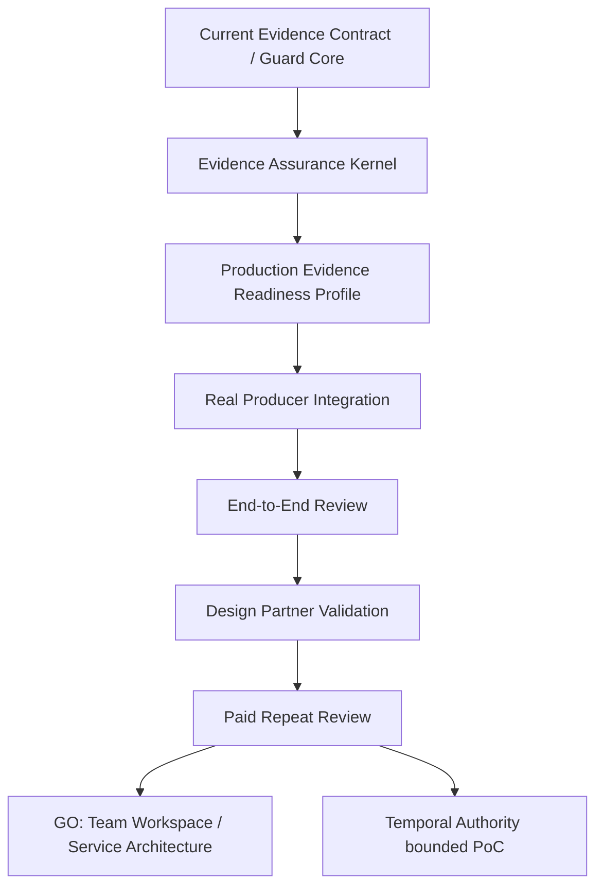

# Production Evidence Readiness Review Validation Plan v0.1

Status: Draft validation plan for 2026-08-27.

## 1. Purpose

[Strategic Baseline] The primary near-term product bet is a repeatable Production Evidence Readiness Review built on a consolidated Evidence Assurance Kernel.

[Repo] The repository already supports:

- local Evidence Pack validation
- local governance report generation
- design-partner trial packaging
- first-report workflow docs
- review-packet framing
- external evidence normalization and assurance type/fixture groundwork

[Inference] What is still unvalidated is whether teams will repeatedly use or pay for a review workflow whose output is evidence sufficiency, contradiction visibility, supplementation requests, and residual uncertainty rather than approval ownership.

## 2. Non-Goals

[Recommendation] This plan is not:

- an implementation plan for new adapters
- a cloud rollout plan
- a commitment gate plan
- a Temporal Authority implementation plan
- a claim that buyers or payment are already validated

## 3. Initial Market Hypothesis

### Buyer

[Hypothesis] The first accountable buyer is an AI platform / engineering owner who is responsible for promoting an AI-assisted workflow or agent into production and needs a defensible evidence packet for internal review. Security and AI governance / risk are likely co-reviewers rather than guaranteed primary buyers.

### Trigger Event

[Hypothesis] The most credible first trigger is a production-entry or material-change review for an AI-assisted workflow, agent, or third-party agent integration.

### Job To Be Done

[Hypothesis] "Before we approve production use externally, help us determine what evidence was submitted, what is only declared, what has been verified, what is still unsupported, what is contradictory, what is missing, and what a human reviewer still needs to decide."

### Existing Pain

[Hypothesis] Evidence is fragmented across source control, CI/CD, runtime logs, evaluation outputs, deployment receipts, and reviewer notes. Reviewers spend time chasing evidence and still cannot easily tell what is actually supported.

### Guard Value

[Hypothesis] Guard can convert fragmented submitted evidence into a deterministic review packet with explicit missing evidence, supportability, contradiction, and residual uncertainty, while keeping the final decision outside Guard.

### Evidence Required

[Hypothesis] The first valuable reviews require more than pack structure: release identity, build/test evidence, provenance, scope, authority context, and at least one independent or cross-system verification surface.

### Recurring Event

[Hypothesis] The recurring event is a second production review for the same workflow after a release, material change, renewal, or re-review.

### Payment Hypothesis

[Hypothesis] A paid pilot is plausible only if the second review is materially faster because Guard retains profile, evidence mapping, and comparison context.

### Main Risk

[Hypothesis] Teams may like the report but still lack a strong recurring owner, strong enough evidence access, or enough cycle-time reduction to pay.

### Validation Method

[Recommendation] Validate with 3-5 real design partners using real review events, then require at least one paid or procurement-backed repeat-use commitment before service expansion.

## 4. Review Job To Be Done

[Recommendation] Production Evidence Readiness Review should answer:

- what evidence was submitted
- who produced it
- which items are declarations only
- which items were verified and by whom
- what conclusions the evidence can support
- what conclusions remain unsupported
- what evidence is missing
- what evidence contradicts other evidence
- what residual uncertainty remains
- what requires human review

Guard provides review evidence, not production certification.

## 5. Production Evidence Readiness Profile v0.1

| Evidence family | Status | Why |
| --- | --- | --- |
| Identity / actor | Conditionally Required | Required when actor ownership or third-party responsibility is material |
| Authority / scope | Required | Needed to know who requested or owns the workflow boundary |
| Workflow / version | Required | Needed to bind the review to a concrete workflow and change set |
| Model / configuration | Conditionally Required | Required when model choice or configuration materially affects risk or behavior |
| Tools | Required | Tooling changes affect capability and risk scope |
| Data / context | Conditionally Required | Required when sensitive data, retrieval context, or production inputs matter |
| Policy | Optional in v0.1 | Useful review context; not every first review has machine-verifiable policy linkage |
| Tests / evaluations | Required | Core evidence for production-entry readiness |
| Runtime evidence | Conditionally Required | Required when the workflow already ran in a pilot, staging, or production-like context |
| Outcome verification | Optional in v0.1 | Valuable but not always available for a first review |
| Security / safety evidence | Conditionally Required | Required for higher-risk workflows or external-facing use |
| Rollback / recovery evidence | Conditionally Required | Required for release and production-change scenarios |
| Provenance | Required | Needed for traceability and evidence integrity |
| Integrity | Required | Needed to distinguish copied declarations from stronger evidence binding |
| Known limitations | Required | Kernel must surface what remains unproven |
| Full ongoing monitoring posture | Out of Scope | Not needed for the first bounded review product |

## 6. Review Workflow

```text
Intake
↓
Validate
↓
Normalize
↓
Verify
↓
Assure
↓
Identify Gaps / Contradictions
↓
Human Review
↓
Request Supplementation
↓
Re-run / Compare
↓
Disposition
↓
Export Review Packet
```

| Step | Input | Output | Guard responsibility | Human responsibility | Producer responsibility |
| --- | --- | --- | --- | --- | --- |
| Intake | Evidence Pack and external evidence refs | Review submission | Accept bounded inputs | Choose review scope | Submit evidence |
| Validate | Submitted pack and artifacts | Structural validity result | Validate contract and pack shape | Review hard failures only if needed | Fix malformed submission |
| Normalize | External evidence payloads | Normalized records | Map external evidence without changing trust | None by default | Provide source payloads |
| Verify | Pack verification entries and external evidence | Verification results and findings | Run bounded verification and record limitations | None by default | Provide verifier-accessible artifacts |
| Assure | Validated evidence and findings | Supportability, admissibility, contradiction, uncertainty view | Form kernel findings | None by default | None |
| Identify gaps / contradictions | Assurance result | Missing-evidence and contradiction set | Make gaps explicit | Prepare judgment questions | Supplement evidence when requested |
| Human review | Review packet | Review comments or disposition | Present, not decide | Accept / reject / request supplementation / defer externally | Answer evidence questions |
| Request supplementation | Review findings | Supplement request | Generate explicit requests | Decide what to request | Submit new evidence |
| Re-run / compare | Revised submission | Delta view | Deterministic compare over retained baseline | Review delta | Submit changed evidence |
| Disposition | Final reviewed packet | Review disposition record | Export bounded result | Own final business decision | None |
| Export review packet | Final artifacts | Traceable packet | Export packet and provenance | Share externally if needed | None |

## 7. Customer-Facing Review Packet

[Recommendation] The packet should include:

- review subject
- review scope
- profile and version
- evidence inventory
- source map
- verification status
- supportability summary
- missing evidence
- contradictions
- residual uncertainty
- human-review items
- reviewer disposition
- provenance and integrity
- comparison to prior submission

Reviewer disposition and external approval remain outside Guard's ownership.

## 8. Design Partner Hypotheses

[Hypothesis] The first 3-5 design partners should have:

- one real AI-assisted workflow or agent
- an accountable decision owner
- a recurring release, renewal, or re-review event
- fragmented evidence across more than one system
- willingness to share synthetic, redacted, or summary evidence first

Candidate buyer-role hypotheses:

- AI Platform / Engineering
- Security
- AI Governance / Risk
- Procurement / Vendor Risk

[Hypothesis] Buyer convergence is currently unvalidated and must be measured rather than assumed.

## 9. Real Evidence Producer Selection Matrix

Scoring uses the weighted categories from the strategic brief and yields a total out of 100.

| Producer category | Relevance | Independence | Availability | Feasibility | Repeat | Prod-readiness | Temporal | Commercial | Total |
| --- | ---: | ---: | ---: | ---: | ---: | ---: | ---: | ---: | ---: |
| CI/CD build and test system | 19 | 12 | 15 | 9 | 10 | 10 | 7 | 9 | 91 |
| Deployment / runtime provenance platform | 18 | 13 | 12 | 8 | 9 | 10 | 8 | 8 | 86 |
| Source control / change identity system | 15 | 10 | 15 | 10 | 10 | 8 | 6 | 7 | 81 |
| Identity / authorization system | 14 | 15 | 8 | 5 | 7 | 7 | 10 | 7 | 73 |
| Evaluation / benchmark system | 15 | 11 | 11 | 7 | 8 | 8 | 5 | 7 | 72 |
| Agent runtime / tool execution logging system | 16 | 10 | 9 | 7 | 8 | 8 | 8 | 6 | 72 |

[Recommendation] First two producer categories:

1. CI/CD build and test systems
2. Deployment / runtime provenance platforms

Why these two first:

- they directly support production-entry and material-change reviews
- they are more likely to exist before specialized AI governance systems do
- they create stronger independent evidence than pack declarations alone
- they leave a clean bridge to future release continuity and Temporal Authority work

## 10. Validation Experiments

### Experiment 0 - Internal Golden Case

- Objective: Validate review semantics with complete, missing, contradictory, and declared-only evidence.
- Input: Existing repo examples, fixtures, first-report artifacts, and external evidence fixtures.
- Success: Review packet clearly distinguishes supportability, missing evidence, contradiction, and residual uncertainty.
- Failure / stop condition: If the semantics are still confusing internally, do not start external partner validation.

### Experiment 1 - Real Producer Dry Run

- Objective: Validate ingestion, normalization, traceability, verifier separation, and supplementation for two real producer categories.
- Input: One CI/CD source and one deployment / runtime provenance source.
- Success: Evidence remains traceable, independent verification is visible, and supplementation requests are specific.
- Failure / stop condition: If normalization is bespoke and non-reusable, stop before broader integration work.

### Experiment 2 - Design Partner Review

- Objective: Run real reviews for 3-5 design partners.
- Input: One real workflow per partner.
- Baseline metrics: review cycle time, reviewer hours, evidence chase effort, supplementation rounds, missing-evidence count, unverified-claim count, decision trace completeness.
- Success: At least one concrete reduction in evidence chase, ambiguity, or reviewer effort.
- Failure / stop condition: If teams only like the report aesthetically but it does not change review work, do not expand.

### Experiment 3 - Paid Or Procurement-Backed Pilot

- Objective: Validate willingness to pay for the review outcome, not only the demo.
- Success evidence: paid pilot, signed pilot agreement, procurement initiation, or budget commitment.
- Failure / stop condition: If no one will fund repeat use, keep the work exploratory.

### Experiment 4 - Repeat Review

- Objective: Prove recurring value on a second review for the same customer.
- Success: retained profile, producer mapping, and baseline make the second review materially faster or lower effort.
- Failure / stop condition: If the second review feels like starting from scratch, do not move to service architecture.

## 11. Success Metrics

### Technical

- evidence normalized successfully
- raw traceability retained
- deterministic rerun
- independent verification coverage increased
- contradiction detection is visible
- supplementation changes assurance state cleanly

### Workflow

- review cycle time reduction
- reviewer effort reduction
- evidence chase reduction
- fewer ambiguous conclusions
- faster second review
- clearer missing-evidence requests

### Commercial

- design partner count
- pilot conversion
- buyer role convergence
- recurring event convergence
- paid commitment
- second-review intent

## 12. Commercial Go / No-Go Gates

[Recommendation] Proceed only if all of the following begin to hold:

1. 3-5 qualified design partners complete real reviews.
2. At least one partner makes a paid or procurement-backed commitment.
3. At least two customers confirm the same recurring review event.
4. Guard measurably reduces review cycle time, audit preparation, evidence chase, or reviewer effort.
5. The second review for at least one customer is materially faster because Guard retains profile, adapter, or baseline context.

## 13. Cloud Go / No-Go Gate

[Recommendation] Do not start Assurance Cloud / Verification Service implementation merely because service-shaped types already exist.

Cloud proceeds only after evidence of:

- repeat use
- collaboration need
- history / retention need
- API integration need
- persistent review value

License Hub must not be repurposed as proof that assurance tenancy is already justified.

## 14. Temporal Authority Handoff Criteria

[Recommendation] Production Evidence Readiness should hand off to a bounded Temporal Authority PoC only when real reviews repeatedly expose one of these cases:

- bind-time authority differs from action-time authority
- release evidence is fresh at submission time but stale at decision time
- delegated scope or actor identity materially changes between reviews
- deployment continuity requires comparing previous and current governed state

If static evidence reviews are sufficient for early customers, Temporal Authority remains future-scoped.

## 15. Kill Criteria

| Area | Kill criterion |
| --- | --- |
| Evidence Assurance Kernel | Critical evidence is consistently unobtainable or unverifiable in real reviews |
| Review product | No clear buyer, low review frequency, checklist already sufficient, or no measurable workflow gain |
| Cloud | No real collaboration, persistence, or repeat-job pain |
| Temporal Authority | Static review remains sufficient and external identity / state integrations are too costly |

## 16. Validation Timeline

| Phase | Objective | Input | Activity | Deliverable | Success gate | Failure / stop condition |
| --- | --- | --- | --- | --- | --- | --- |
| Phase 0 | Internal semantic freeze | Existing repo examples and fixtures | Golden-case review design | Internal review packet examples and metric template | Team agrees semantics are reviewable | Internal confusion remains high |
| Phase 1 | Real producer dry run | Two producer categories | Normalize, verify, supplement, compare | Producer-specific dry-run packet | Reusable mapping pattern appears | Every producer needs bespoke semantics |
| Phase 2 | Design partner reviews | 3-5 partner workflows | Real review runs | Partner review packets and outcome notes | Workflow value is visible | Only demo enthusiasm, no workflow change |
| Phase 3 | Paid or procurement-backed pilot | Strongest partner(s) | Repeatable review with funding test | Pilot agreement or procurement motion | One funded commitment | No funding signal |
| Phase 4 | Repeat review proof | Same customer second event | Re-run with retained baseline | Second-review delta packet | Faster second review | No repeat-use advantage |

## 17. Product / Architecture Dependency Map



## 18. Project Context Traceability

| Decision / Proposal | Existing Repository Basis | Strategic Assessment Basis | New Inference |
| --- | --- | --- | --- |
| Start from review packet, not control plane | first-report, trial kit, security review packet, Studio boundary | review workflow is the nearest product wedge | Readiness Review should be the first validation shape |
| Require repeat-review proof before cloud | external evidence service types are present but unimplemented | recurring value is the commercial gate | service work is conditional, not automatic |
| Prioritize CI/CD and deployment provenance | existing Evidence Pack already covers workflow, verification, provenance concepts | production-entry review and release continuity are strongest near-term adjacencies | these two producers maximize first validation value |
| Keep buyer claims as hypotheses | repo contains adoption docs but no revenue proof | strategic baseline says willingness to pay is unvalidated | buyer, payment, and urgency must be tested explicitly |

## 19. Recommended Next Step

[Recommendation] The next step after this plan is a bounded PoC, not cloud rollout:

- implement the minimum Evidence Assurance Kernel semantics needed for Production Evidence Readiness Profile v0.1
- connect the first two real producer categories
- run Experiment 0 and Experiment 1 before broad design-partner outreach

[Recommendation] Do not move to service architecture until Experiment 4 demonstrates repeat-review leverage.

## 20. Bounded PoC Notes

[Repo] On 2026-08-27 the bounded PoC implementation added:

- internal Evidence Assurance Kernel semantics in `packages/guard-core/src/evidenceAssuranceKernel.ts`
- deterministic Experiment 0 coverage in `scripts/verify_evidence_assurance_kernel_poc.mjs`
- a local governance-mapping preview fixture at `scripts/fixtures/local_governance_mapping_preview.case-e.json`
- a local Production Evidence Readiness review preview fixture at `scripts/fixtures/production_evidence_readiness_review_preview.case-c.json`

[Repo] Experiment 2 measurement readiness is prepared separately in:

- `docs/strategy/production-evidence-readiness-measurement-template-v0.1.md`

[Repo] Experiment 1 remains gated on real artifact availability and secret-safe access clarity.
